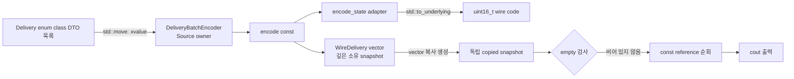

# 2026-10-14 — `std::to_underlying` 직렬화 경계와 Suffix Automaton

오늘의 실무 주제는 C++23 `std::to_underlying`으로 **강한 `enum class`를 저장/API 숫자로 낮추는 위치를 adapter 한곳에 제한**하는 것이다. 대회 문제는 [CSES 2105 — Distinct Substrings](https://cses.fi/problemset/task/2105/)이며, suffix automaton이 부분 문자열의 `endpos` 동치류를 모든 `n>=1`에서 최대 `2n`개 상태로 압축한다는 성질을 이용한다.

## 오늘의 학습 목표

1. `enum class`와 정수 사이의 암시 변환을 막고 wire code를 명시적으로 고정한다.
2. `std::to_underlying(state)`의 타입·인자·반환·상태·오류/수명 계약을 실제 식으로 설명한다.
3. 값 매개변수, `const` 참조, 비소유 포인터, 복사·이동, lvalue/prvalue/xvalue, RVO를 소유권과 연결한다.
4. suffix automaton의 `longest`, `suffix_link`, 전이, clone 불변식을 증명하고 구현한다.
5. `sum(longest[v] - longest[link[v]])`가 서로 다른 부분 문자열 수가 되는 이유를 설명한다.

## 생성 파일

- [`main.cpp`](main.cpp): 강한 배송 상태를 독립 소유 wire snapshot으로 바꾸는 실무 adapter
- [`problem.cpp`](problem.cpp): 비트 권한 enum을 조합·조회·직렬화하는 직접 연습
- [`icpc_problem.cpp`](icpc_problem.cpp): CSES 2105 제출 가능한 완전한 suffix automaton 풀이
- [`CMakeLists.txt`](CMakeLists.txt): C++23 세 실행 파일과 정확 출력 테스트 10개
- [`run_icpc_test.cmake`](run_icpc_test.cmake): 종료 코드와 stdout 전체를 비교하는 helper
- [`CHECKPOINT.md`](CHECKPOINT.md): 기초 문법, 값 범주, 호출 계약, 알고리즘 증명 검증
- [Suffix Automaton 대표 문서](../algorithm/suffix-automaton-distinct-substrings.md)

## `main.cpp` 구조도



핵심 경계는 `DeliveryState`를 내부 도메인 타입으로 유지하다가 `encode_state`에서만 숫자로 낮추는 것이다. `WireDelivery`는 원본 문자열을 깊게 복사하므로 encoder보다 오래 살아도 dangling되지 않는다.

## 초보자를 위한 기초 문법

### 타입과 초기화

- `std::uint16_t`는 구현이 제공할 때 정확히 16비트인 부호 없는 정수 별칭이다. 외부 형식의 폭을 평범한 `unsigned`보다 분명히 한다.
- `DeliveryState state{}`와 `std::uint16_t state_code{}`의 `{}`는 값 초기화다. 둘 다 기저 정수 값 0으로 시작한다. `DeliveryState`에는 0인 열거자가 없으므로 기본값을 도메인 유효 상태로 오해하지 않고 실제 DTO 생성 때 상태를 명시한다.
- `enum class`는 `DeliveryState::queued`를 정수 10과 자동으로 섞지 않는다. 강한 타입의 안전성은 도메인 내부에서 유지하고 adapter에서만 명시적으로 변환한다.

### 함수, 매개변수, 반환형

- `encode_state(DeliveryState state)`는 작은 enum을 값으로 받는다. 호출자의 객체와 독립된 복사라 dangling 참조가 없다.
- `print_policy(const PermissionSet& policy)`의 `const &`는 객체를 소유하지 않고 읽기만 한다. 참조는 null이 될 수 없고 재바인딩할 수 없지만 원본 수명을 연장하지 않는다.
- `const WireDelivery* const first`에서 왼쪽 `const`는 가리킨 원소를 못 바꾸게 하고 오른쪽 `const`는 포인터 자체의 재바인딩을 막는다. 포인터 타입은 null을 표현할 수 있지만 오늘 초기값은 `copied` 원소 주소이며, vector 구조 변경이나 파괴 뒤 사용하면 안 된다.
- `[[nodiscard]]`는 의미 있는 반환값을 실수로 버릴 때 진단을 유도한다. `noexcept`는 함수 밖으로 예외를 전파하지 않는다는 타입 계약이다.

### `struct`, `class`, 접근 지정자와 생성자

- `struct Delivery`의 멤버는 기본 `public`이라 단순 데이터 운반에 알맞다.
- `class DeliveryBatchEncoder`의 멤버는 기본 `private`이며 `deliveries_` 소유권을 감춘다. `public:`은 호출자에게 허용한 동작만 연다.
- `explicit DeliveryBatchEncoder(Source)`는 vector 하나가 encoder로 뜻밖에 암시 변환되는 일을 막는다.
- `: deliveries_{std::move(deliveries)}`는 생성자 본문 전에 멤버를 직접 완성하는 **멤버 초기화 목록**이다.
- `using Source = std::vector<Delivery>`는 긴 template 특수화에 이름을 붙일 뿐 상속이나 새 강한 타입을 만들지 않는다. `Delivery`가 template 인자다.

### 제어문과 직접 해보기

- `if (copied.empty())`는 bool 결과가 참일 때만 조기 반환한다. 빈 vector에 `operator[](0)`을 적용하는 UB를 먼저 차단한다.
- range-for는 내부적으로 `begin`, `end`, 비교, 역참조, 증가를 수행한다. 순회 중 vector 구조를 바꾸지 않는다.
- 직접 해보기: `DeliveryState::cancelled = 40U`를 추가하고 출력 기대값까지 갱신한다.
- 직접 해보기: 열거자 값을 생략한 뒤 순서를 바꾸어 저장 형식이 왜 불안정해지는지 비교한다.
- 직접 해보기: `first`를 함수 밖에 저장한 뒤 `copied`가 파괴되는 설계를 그림으로만 분석하고 실행하지 않는다.

## Modern C++ 심화와 아키텍처 역할

### `std::to_underlying` 경계

`std::to_underlying(state)`는 C++23 자유 함수 template이다. enum 값을 같은 기저 정수 타입 prvalue로 반환하며 상태를 바꾸거나 메모리를 할당하지 않는다. 역방향 `static_cast<DeliveryState>(wire)`는 모든 숫자를 자동 검증하지 않는다. 외부에서 받은 숫자는 허용 code 집합을 먼저 검사한 뒤 도메인 enum으로 올려야 한다.

이 패턴은 DB column, JSON/protobuf adapter, telemetry tag, C ABI 같은 경계에 유용하다. 도메인 전체에서 `static_cast<int>`를 흩뿌리지 않으므로 wire compatibility 검토와 테스트 위치가 한곳으로 모인다.

### 값 범주, 참조 바인딩, 복사·이동·수명

- `seed`는 이름이 있는 lvalue다. `std::move(seed)`는 같은 객체를 가리키는 xvalue 참조를 만들 뿐 실제 이동은 하지 않는다. 첫 vector 이동 생성자가 값 매개변수 `deliveries`를 만들고, 생성자 안 `std::move(deliveries)` 뒤 두 번째 vector 이동 생성자가 `deliveries_`를 만든다. 두 단계 모두 소유권 경계이며 최종 멤버가 저장소를 소유한다.
- `WireDelivery{...}`는 prvalue다. `push_back(value_type&&)`가 그 임시 객체를 마지막 원소로 이동 구성한다.
- `delivery.tracking_id`는 `const std::string` lvalue라 새 snapshot 문자열은 복사 생성된다. 두 vector는 문자 저장소를 공유하지 않는다.
- `const Delivery& delivery`는 vector 원소에 바인딩된 비소유 lvalue reference다. 순회 동안 owner와 구조가 유지되어 안전하다.
- `return result;`의 이름 있는 local은 NRVO 후보다. NRVO가 적용되지 않아도 반환 문맥의 암시적 이동이 가능하다. 호출 결과 prvalue는 `encoded`를 직접 초기화한다.
- `const Snapshot copied{encoded}`는 명시적인 깊은 복사다. 복사와 이동의 비용·수명 의미를 같은 코드에서 비교할 수 있다.

### 기계 실행 관점

enum 변환과 비트 연산은 정수 load/연산으로, suffix automaton은 연속 상태 배열의 load/store·문자 비교·조건 분기로 낮아질 수 있다. stream 출력에는 버퍼와 형식화 계층이 관여할 수 있다. 실제 인라이닝, 분기 제거, cache miss, 간접 호출과 명령 선택은 CPU·ABI·표준 라이브러리·컴파일러·최적화 옵션에 따라 달라지므로 특정 어셈블리로 단정하지 않는다.

## 오늘의 ICPC 문제

- ID·제목: **CSES 2105 — Distinct Substrings**
- 공식 출처 URL: <https://cses.fi/problemset/task/2105/>
- 입력: 소문자 `a`~`z`로만 이루어진 길이 `1 <= n <= 100,000` 문자열 하나
- 출력: 서로 다른 연속 부분 문자열의 개수
- 공식 예제: `abaa -> 8`
- 핵심 알고리즘: Suffix Automaton(SAM), suffix link, clone, endpos 동치류
- 대표 문서: [`../algorithm/suffix-automaton-distinct-substrings.md`](../algorithm/suffix-automaton-distinct-substrings.md)

### 핵심 불변식과 정답식

상태 `v`는 같은 종료 위치 집합을 갖는 부분 문자열들을 대표한다. 그 길이는 정확히 다음 정수 구간이다.

```text
(longest[link[v]], longest[v]]
```

따라서 root를 제외한 상태마다 `longest[v] - longest[link[v]]`개의 서로 다른 부분 문자열이 있고, 이 구간들은 중복 없이 전체 부분 문자열을 분할한다. 문자를 추가할 때 길이 연속성이 깨지는 기존 상태 `q`는 clone으로 분리한다. clone은 `q`의 전이와 suffix link를 복사하되 `longest`만 `longest[p]+1`로 줄여 전이의 결정성과 길이 불변식을 동시에 회복한다.

### 복잡도

- 상태 수: 모든 `n>=1`에서 최대 `2n`; `n>=2`의 더 타이트한 상한은 `2n-1`
- 시간: 고정 알파벳 26에서 `O(n * 26) = O(n)`; clone의 26개 전이 복사를 포함한다.
- 공간: `O(n * 26) = O(n)`
- 답은 최대 `n(n+1)/2 = 5,000,050,000`이므로 32비트 signed 정수가 아니라 `std::int64_t`를 쓴다.

### 대회 우승권 점검

- `0`은 전이 부재, root는 `1`로 두어 zero-initialized `std::array`를 즉시 쓴다.
- 상태 저장소를 처음부터 `2n+1`개 만들어 확장 중 vector 재할당과 참조 무효화를 없앤다.
- clone은 terminal 추가 상태가 아니며 `q/current`의 suffix link만 재연결한다.
- 전이 redirect loop는 값이 정확히 `q`인 suffix 조상만 clone으로 바꾼다.
- 답의 각 차이는 `int` 범위지만 총합은 64비트에 누적한다.
- 작은 문자열은 모든 부분 문자열을 set으로 세는 오라클과 차등 테스트한다.

## 오늘 사용한 표준 라이브러리

| 핵심 심볼명 | 선언 헤더 | 항목 종류 | 실제 호출 멤버/함수 | 현재 코드에서의 역할 | 대표 문서 |
|---|---|---|---|---|---|
| `std::to_underlying` | `<utility>` | C++23 자유 함수 template | `std::to_underlying(state)` | 강한 enum을 adapter에서만 기저 정수 값으로 변환 | [입출력·유틸리티](../standard-library/io-parsing-and-utilities.md) |
| `std::move` | `<utility>` | 값 범주 변환 함수 template | `std::move(seed)`, `std::move(deliveries)` | vector owner 이동을 허용하는 xvalue 생성 | [입출력·유틸리티](../standard-library/io-parsing-and-utilities.md) |
| `std::string` | `<string>` | 소유 문자열 class | 기본/리터럴 생성자, 복사·이동 생성자, `std::string::size`, `std::string::operator[]`, `string::empty()` | 입력과 추적 번호 문자를 독립 소유 | [컨테이너](../standard-library/containers-and-views.md) |
| `std::vector<T>` | `<vector>` | 동적 연속 컨테이너 class template | 기본 생성자, initializer-list 생성자, count 생성자, 이동/복사 생성자 | DTO snapshot과 SAM 상태 저장소 소유 | [컨테이너](../standard-library/containers-and-views.md) |
| `vector::size` / `vector::reserve` | `<vector>` | 관찰/용량 멤버 함수 | `deliveries_.size()`, `result.reserve(count)` | snapshot 크기를 보존한 채 재할당을 미리 방지 | [컨테이너](../standard-library/containers-and-views.md) |
| `vector::push_back` | `<vector>` | 수정 멤버 함수 | `result.push_back(prvalue)` | 독립 소유 wire DTO를 끝에 이동 삽입 | [컨테이너](../standard-library/containers-and-views.md) |
| `vector::empty` / `vector::operator[]` | `<vector>` | 관찰 멤버/연산자 | `copied.empty()`, `copied[0]`, `states_[index]` | 빈 범위 방어와 검증된 O(1) 상태 접근 | [컨테이너](../standard-library/containers-and-views.md) |
| vector range-for 숨은 연산 | `<vector>` | iterator 연산 | `begin/end`, 비교, 역참조, 증가 | 소유 원소를 `const&`로 복사 없이 순회 | [컨테이너](../standard-library/containers-and-views.md) |
| `std::array<int,26>` | `<array>` | 고정 크기 aggregate | 값 초기화, 복사 대입, `operator[]` | SAM 상태별 소문자 전이 26개 | [컨테이너](../standard-library/containers-and-views.md) |
| `std::uint16_t`, `std::int64_t`, `std::size_t` | `<cstdint>`, `<cstddef>` | 기본 타입 별칭 | 값 초기화·산술·변환 | wire 폭, 64비트 답, 크기/인덱스 표현 | [비트·바이트](../standard-library/bit-and-byte-utilities.md) |
| `std::ios::sync_with_stdio` | `<iostream>` | 정적 설정 함수 | `sync_with_stdio(false)` | ICPC 단일 스레드 iostream 설정 | [입출력·유틸리티](../standard-library/io-parsing-and-utilities.md) |
| `std::cin.tie` | `<iostream>` | stream 연결 멤버 함수 | `std::cin.tie(nullptr)` | 입력 전 자동 출력 flush 연결 해제 | [입출력·유틸리티](../standard-library/io-parsing-and-utilities.md) |
| `std::cin` 추출 | `<iostream>`, `<string>` | stream 비멤버 연산자 | `std::cin >> text`, `basic_ios::operator!` | 입력 문자열 소유 및 실패 검사 | [입출력·유틸리티](../standard-library/io-parsing-and-utilities.md) |
| `std::cout` 삽입 | `<iostream>` | stream 멤버/비멤버 연산자 | `std::cout << ...`, `operator<<(std::ostream&, char)` | DTO와 정답을 순서대로 출력 | [입출력·유틸리티](../standard-library/io-parsing-and-utilities.md) |

## 검증 과정과 실제 결과

- 기존 69개 날짜, 자동화 메모리, Git 기록, 알고리즘 대표 문서 46개를 검색해 CSES 2105와 suffix automaton이 미사용임을 확인했다.
- 공식 CSES 페이지에서 시간 제한 1초, 메모리 512MB, `n<=100000`, 공식 예제 `abaa -> 8`을 확인했다.
- 저장소 w64devkit GCC 16.1.0에서 세 소스를 C++23과 `-Wall -Wextra -Wpedantic -Wconversion -Wshadow -Werror -D_GLIBCXX_ASSERTIONS`로 검사했다.
- CMake Release 빌드와 CTest **10/10**이 통과했다. 공식 예제, 길이 1, 모두 같은 문자, 모두 다른 문자, 주기 문자열, `banana`, clone-heavy 최대 길이와 `2,500,100,000`인 64비트 답을 정확 출력으로 검사했다.
- seed `20261014`의 길이 1~11 무작위 문자열 600건을 모든 부분 문자열 `HashSet` 오라클과 대조해 600/600 통과했다.
- seed `20261014`, 길이 100,000 무작위 소문자 stress는 97ms에 범위 검사를 통과했고 답은 `4,999,757,501`이었다. 시간은 이 실행 환경의 관측값이지 이식 가능한 성능 보장이 아니다.
- 표준 라이브러리 감사의 `latest`와 `all` 범위가 모두 통과했고, 이번 변경 문서 10개의 로컬 Markdown 링크 372개가 모두 실제 경로를 가리켰다.

## 재현 명령

```powershell
$kit = (Resolve-Path tools/w64devkit/bin).Path
$env:PATH = $kit + ';' + $env:PATH
cmake -S dailystudy/exercise/2026-10-14 -B build/daily-2026-10-14 -G "MinGW Makefiles" -DCMAKE_BUILD_TYPE=Release "-DCMAKE_CXX_COMPILER=g++.exe"
cmake --build build/daily-2026-10-14 --parallel
ctest --test-dir build/daily-2026-10-14 --output-on-failure
powershell -ExecutionPolicy Bypass -File dailystudy/exercise/tools/audit-standard-library-docs.ps1 -Scope all
```

빌드 산출물은 저장소에서 무시되는 `build/daily-2026-10-14` 아래에만 둔다.
