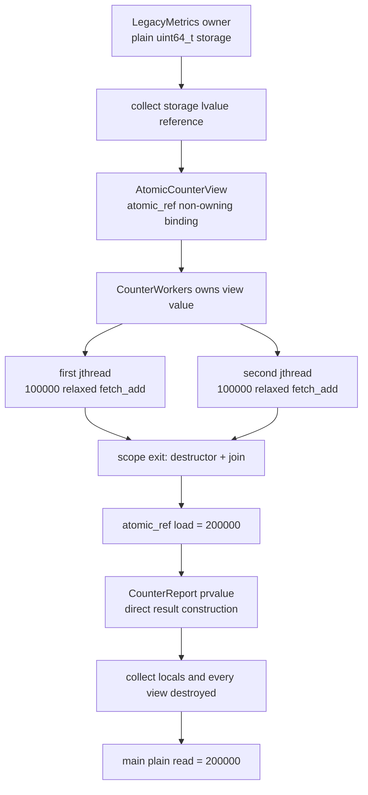

# 2026-10-15 — `std::atomic_ref` 레거시 저장소 경계와 k개 최단 Walk

오늘의 실무 주제는 C++20 `std::atomic_ref<T>`로 **이미 존재하는 평범한 저장소의 필드 타입과 소유권을
바꾸지 않은 채, 짧은 범위에서만 원자 접근 능력을 빌리는 adapter 경계**를 만드는 것이다. 예제 owner는
필요한 정렬을 처음부터 선언한다. 이미 동결된 외부 ABI의 정렬이 부족하다면 `alignas`를 나중에 보태
레이아웃을 바꾸면 안 되고, 그 저장소에는 `atomic_ref`를 사용할 수 없다. `LegacyMetrics`와
`LegacySequence`가 실제 정수를 소유하고, view와 worker가 모두 사라진 뒤에만 다시 plain read를 한다.
대회 문제는 [CSES 1196 — Flight Routes](https://cses.fi/problemset/task/1196/)다.
최소 힙에서 walk 접두사를 비용순으로 꺼내고 정점별 유효 pop을 `k`번까지 허용하여, 같은 가격도
중복을 유지한 k개 최단 route 비용을 구한다.

## 오늘의 학습 목표

- `struct`의 plain `std::uint64_t` 필드를 owner로 유지하면서 `std::atomic_ref`를 비소유 view로 붙인다.
- `required_alignment`, trivially-copyable 타입, owner 수명, atomic-only access epoch를 설명한다.
- `memory_order_relaxed`가 카운터 한 값의 원자성만 보장하고 주변 payload 게시를 보장하지 않음을 안다.
- `std::jthread`의 RAII 소멸·join이 worker 완료와 이후 읽기 사이에 만드는 동기화를 구분한다.
- lvalue/prvalue/xvalue, 참조 바인딩, view 복사·이동, 객체 수명, 소유권, 보장된 복사 생략을 실제 식에
  연결한다.
- k-shortest **walk**와 단일 최단 경로·k개 최단 단순 경로의 차이를 구분하고 pop-count 불변식을
  증명한다.
- 표준 라이브러리 첫 호출의 수신자·오버로드·각 인자·반환·사후 상태·오류/수명 계약을 코드에서 읽는다.

## 생성 파일

- [`README.md`](README.md): 오늘의 문법, 구조도, 문제, 호출 계약, 검증 기록
- [`CMakeLists.txt`](CMakeLists.txt): 세 C++23 실행 파일과 전체 출력 CTest
- [`main.cpp`](main.cpp): legacy metric owner와 원자 counter view를 분리한 실무형 예제
- [`problem.cpp`](problem.cpp): 두 worker가 ID 1~8을 중복 없이 발급하는 직접 연습
- [`CHECKPOINT.md`](CHECKPOINT.md): 기초 문법·수명·원자 계약·알고리즘 식 해석 검증
- [`icpc_problem.cpp`](icpc_problem.cpp): CSES 1196에 제출 가능한 완전한 풀이
- [`run_icpc_test.cmake`](run_icpc_test.cmake): 종료 코드와 stdout 전체 비교 helper
- [`../algorithm/k-shortest-walks-best-first.md`](../algorithm/k-shortest-walks-best-first.md): 공용 알고리즘 대표 문서

## `main.cpp` 구조도



점선이나 화살표가 소유권 이동을 뜻하는 것은 아니다. 실제 owner는 처음부터 끝까지
`LegacyMetrics` 하나다. `AtomicCounterView`, lambda capture, `CounterWorkers`의 복사·이동은 모두 같은
숫자를 가리키는 **비소유 binding**을 하나 더 만들 뿐이다. 따라서 `J`보다 앞에서 `storage.completed`를
직접 읽으면 안 된다.

## 초보자를 위한 문법 지도

- `struct LegacyMetrics`의 멤버는 기본 `public`이다. 값만 담는 외부/레거시 레이아웃을 표현하기 좋다.
- `class AtomicCounterView`의 멤버는 기본 `private`다. 사용자는 `increment()`와 `load()`만 보고 내부
  atomic handle은 직접 만지지 못한다.
- `std::uint64_t completed{}`의 `{}`는 0으로 값 초기화한다. `next_id{1}`은 1로 직접 초기화한다.
- `using Value = std::uint64_t;`는 새 타입을 만들지 않고 긴 이름에 별칭을 붙인다.
- `std::atomic_ref<Value>`에서 `Value`는 class template 인자다.
- `explicit AtomicCounterView(Value& storage)`는 `uint64_t`가 view로 뜻밖에 암시 변환되는 것을 막는다.
- `: completed_{storage}`는 생성자 본문보다 먼저 멤버를 직접 만드는 멤버 초기화 목록이다.
- `Value&`는 null이 될 수 없고 재바인딩되지 않는 비소유 별칭이다. owner 수명을 연장하지 않는다.
- `const` 멤버 함수는 view의 binding을 바꾸지 않는다는 뜻이다. 가리킨 외부 숫자에 허용된 원자 연산을
  수행할 수 없다는 뜻은 아니다.
- `for (std::uint64_t i{}; i < iterations; ++i)`는 초기화, 비교, 본문, 증가 순서로 반복한다.
- `if`와 `while`은 비교 결과에 따라 조건 분기한다. 구체적인 CPU 분기나 branchless 변환 여부는
  컴파일러·CPU·최적화 옵션에 따라 달라진다.

## 값 범주·복사/이동·수명·소유권

`storage.completed`는 이름 있는 객체를 나타내는 lvalue다. `AtomicCounterView{storage.completed}`는 새 view
prvalue이며, `std::move(counter)`는 이름 있는 `counter` lvalue를 같은 객체를 가리키는 xvalue 식으로
바꾼다. `std::move` 자체는 값도 숫자도 옮기지 않는다. 이 wrapper의 이동 생성은 `atomic_ref` binding을
복사하므로 source와 destination 모두 같은 외부 숫자를 가리킨다. 이는 owning container의 이동과 전혀
다르다.

worker lambda는 view를 값으로 소유하지만 underlying 숫자는 소유하지 않는다. owner인 `LegacyMetrics`가
lambda와 `jthread`보다 먼저 생성되고 나중에 파괴되어야 한다. `CounterReport{counter_.load()}`는 prvalue로
반환 결과 객체를 직접 초기화하므로 C++17 이후 중간 복사/이동이 필요 없다. 이름 있는 local을 반환하는
NRVO와 prvalue 보장 복사 생략은 비슷해 보여도 규칙이 다르다.

## `atomic_ref` 안전 규칙과 실행 관점

1. `T`는 trivially copyable이어야 하고 mutable 대상의 주소는
   `std::atomic_ref<T>::required_alignment`를 만족해야 한다. layout을 설계할 수 있을 때만 `alignas`로
   이를 선언하며, 고정된 외부 ABI는 실제 주소 정렬을 먼저 검증한다.
2. 대상 owner는 그 대상을 가리키는 모든 `atomic_ref`보다 오래 살아야 한다.
3. 하나라도 view가 살아 있는 동안 그 대상의 모든 접근은 같은 대상을 가리키는 `atomic_ref`를 통해야
   한다. direct plain read/write를 섞지 않는다.
4. `fetch_add(1, std::memory_order_relaxed)`는 숫자 하나의 원자 read-modify-write와 modification order는
   보장하지만 다른 필드를 게시하지 않는다.
5. 이 예제에서 worker의 완료와 합계 관찰을 연결하는 것은 relaxed 연산이 아니라 `jthread`의 성공한
   join이다.
6. `atomic_ref`는 lock-free라고 보장되지 않는다. 정렬된 load/store/RMW 한 명령, fence, 라이브러리
   잠금 중 무엇으로 낮아지는지는 CPU·ABI·컴파일러·표준 라이브러리·최적화 옵션에 따라 다르다.

## 오늘의 ICPC 문제

- 문제 ID/제목: **CSES 1196 — Flight Routes**
- 출처: [CSES Problem Set 공식 페이지](https://cses.fi/problemset/task/1196/)
- 조건: `2 <= n <= 100000`, `1 <= m <= 200000`, `1 <= k <= 10`, 단방향 양의 비용 간선,
  1번에서 n번까지 적어도 k개 route 존재
- 핵심 알고리즘: 최소 힙 best-first walk 열거 + 정점별 최대 k번의 유효 pop
- 시간 복잡도: `O(km log(km))`
- 공간 복잡도: 인접 리스트·카운터·힙을 합쳐 `O(n + m + km)` 최악 상한

힙 원소 `(cost, vertex)`는 정점의 최종 거리 하나가 아니라 실제로 발견한 **walk 접두사 하나**다.
같은 비용과 정점의 원소도 합치지 않는다. 정점 `v`의 r번째 유효 pop은 `v`까지의 r번째 최소 walk
비용이며, `(k+1)`번째 이후의 접두사에 같은 suffix를 붙인 완성 walk보다 비싸지 않은 대체 walk가 이미
k개 있으므로 그 뒤 후보는 확장할 필요가 없다. 이 불변식 때문에 도착점의 첫 k번 유효 pop이 곧 답이다.

대회에서 특히 조심할 점은 다음과 같다.

- push 횟수가 아니라 **pop 뒤 받아들인 횟수**를 센다.
- 같은 가격 route도 각각 답이므로 `set`, `unique`, visited boolean으로 합치지 않는다.
- k번째 답 전에는 도착점도 확장한다. 도착점을 지나 되돌아오는 유효 walk가 있을 수 있다.
- 누적 비용은 `std::int64_t`로 두고 덧셈 전에 `MAX - edge.cost`와 비교한다.
- 기본 `priority_queue`는 최대 힙이므로 비교자의 방향을 반대로 정의한다.

## 오늘 사용한 표준 라이브러리

| 핵심 심볼 | 선언 헤더 | 항목 종류 | 실제 호출 멤버/함수 | 현재 코드에서의 역할 | 대표 문서 |
|---|---|---|---|---|---|
| `std::atomic_ref<T>` | `<atomic>` | C++20 class template, 비소유 handle | `std::atomic_ref<Value>(Value&)`, 복사 생성 | plain legacy 숫자에 제한된 원자 접근 능력을 결합 | [동시성](../standard-library/concurrency-time-filesystem.md) |
| `atomic_ref::fetch_add` | `<atomic>` | const 원자 RMW 멤버 | `atomic_ref::fetch_add(1, memory_order_relaxed)` | 두 worker의 증가/ID 발급을 중복 없이 직렬화 | [동시성](../standard-library/concurrency-time-filesystem.md) |
| `atomic_ref::load` | `<atomic>` | const 원자 읽기 멤버 | `atomic_ref::load(memory_order_relaxed)` | join 뒤 원자 epoch 안에서 최종 카운터 관찰 | [동시성](../standard-library/concurrency-time-filesystem.md) |
| `std::memory_order_relaxed` | `<atomic>` | 열거 상수 | `fetch_add`, `load`의 두 번째/유일한 순서 인자 | 한 숫자의 원자성만 요구하고 payload 게시와 분리 | [동시성](../standard-library/concurrency-time-filesystem.md) |
| `std::jthread` | `<thread>` | RAII thread class | `std::jthread(callable)`, destructor/request_stop/join | worker 실행 수명을 scope에 묶고 완료를 동기화 | [동시성](../standard-library/concurrency-time-filesystem.md) |
| `std::move` | `<utility>` | 값 범주 변환 함수 template | `std::move(counter)`, `std::move(view)` | 이름 있는 비소유 wrapper를 xvalue로 전달 | [입출력·유틸리티](../standard-library/io-parsing-and-utilities.md) |
| `std::uint64_t`, `std::int64_t`, `std::size_t` | `<cstdint>`, `<cstddef>` | 기본 정수 타입 별칭 | 초기화·비교·산술·인덱싱 | 원자 값, 64비트 비용, 컨테이너 크기 표현 | [비트·바이트](../standard-library/bit-and-byte-utilities.md) |
| `std::vector<T>` | `<vector>` | 동적 연속 container template | count/fill/기본 생성자, `vector::operator[]`, `vector::reserve`, `vector::push_back`, `vector::size` | 인접 리스트·pop 횟수·답을 소유 | [컨테이너](../standard-library/containers-and-views.md) |
| `std::priority_queue` | `<queue>` | container adaptor class template | 기본 생성, `priority_queue::push`, `priority_queue::empty`, `priority_queue::top`, `priority_queue::pop` | 아직 처리하지 않은 walk 접두사의 최소 힙 | [컨테이너](../standard-library/containers-and-views.md) |
| `std::ios::sync_with_stdio` | `<iostream>` | 정적 stream 설정 함수 | `sync_with_stdio(false)` | ICPC 단일 스레드 입출력 설정 | [입출력](../standard-library/io-parsing-and-utilities.md) |
| `std::cin.tie` | `<iostream>` | stream 연결 멤버 | `std::cin.tie(nullptr)` | 입력 전 자동 출력 flush 연결 해제 | [입출력](../standard-library/io-parsing-and-utilities.md) |
| `std::cin` 추출 | `<iostream>` | stream 연산자 | `std::cin >> ...`, `basic_ios::operator!` | 문제 입력을 값 객체에 저장하고 첫 실패 검사 | [입출력](../standard-library/io-parsing-and-utilities.md) |
| `std::cout` 삽입 | `<iostream>` | stream 멤버/비멤버 연산자 | `std::cout << ...`, `operator<<(std::ostream&, char)` | 학습 결과와 k개 비용을 형식화해 출력 | [입출력](../standard-library/io-parsing-and-utilities.md) |

## 직접 해보기와 초보자 검증 단계

1. `main.cpp`의 반복 횟수를 worker당 3으로 바꾸고 출력 `6 6`을 먼저 예측한 뒤 실행한다.
2. worker scope 안에서 `storage.completed`를 직접 읽는 줄을 종이에만 적고, 어떤 규칙을 깨는지 설명한다.
   실제 프로그램에는 넣지 않는다.
3. `problem.cpp`의 worker당 발급 수를 5로 바꾸고 전체 합 `55`, 다음 ID `11`을 계산한다.
4. `memory_order_relaxed`를 `seq_cst`로 바꿨을 때 값 정확성은 같지만 어떤 순서 제약이 추가되는지 말한다.
5. CSES 예제의 힙 pop 순서를 손으로 추적하고 비용 4가 두 번 답에 남는 이유를 간선열로 적는다.
6. `accepted`를 boolean visited로 바꾸면 두 번째 route부터 잃는 최소 반례를 만든다.
7. [`CHECKPOINT.md`](CHECKPOINT.md)의 식 해석 문제를 자료 없이 풀고, 각 표준 호출의 매개변수·반환값·
   무효화·오류 계약을 말로 설명한다.

## 검증 과정과 실제 결과

- 기존 70개 날짜, 자동화 메모리, 알고리즘 대표 문서 47개를 검색해 CSES 1196과 k-shortest-walk,
  `std::atomic_ref`가 모두 미사용임을 확인했다.
- 공식 CSES 페이지에서 시간 1초, 메모리 512MB, 입력 제약, 정점 재방문 허용, 같은 가격 route도 각각
  세는 조건과 공식 예제 `4 4 7`을 확인했다.
- 저장소 w64devkit GCC 16.1.0에서 세 소스를 C++23과
  `-Wall -Wextra -Wpedantic -Wconversion -Wshadow`로 빌드했다.
- CMake Release 빌드와 현재 CTest **7/7**이 공식 예제, 평행 간선 중복, 양의 cycle, 직접/반복 경로
  혼합, 64비트 비용, 두 Modern C++ 출력 전체를 검사한다.
- `main.cpp`와 `problem.cpp`는 엄격 경고와 `_GLIBCXX_ASSERTIONS` 조건에서 각각 100회 반복해 결정적인
  `200000 200000`, `36 9`와 종료 코드 0을 확인했다.
- seed `20261015`의 작은 무작위 DAG 1,500건은 모든 route를 완전 열거한 독립 오라클과 1,500/1,500
  일치했다. seed `119620261015`의 양의 cycle·self-loop·평행 간선을 포함한 무작위 그래프 1,000건은
  정점별 pruning이 없는 명시적 walk 오라클과 1,000/1,000 일치했다.
- 최대 `n=100000`, `m=200000`, `k=10`인 이중 사슬 stress는 기대한 열 비용을 출력했고 이 환경에서
  약 66.3ms였다. 이 관측 시간은 이식 가능한 성능 보장이 아니다.
- 표준 라이브러리 감사의 `latest`와 `all`이 각각 3개/194개 C++ 파일, 전체 189개 심볼과 57개 헤더에
  대해 통과했다. 변경·생성 파일 14개의 엄격 UTF-8/final-LF와 376개 로컬 Markdown 링크도 통과했다.

## 재현 명령

```powershell
$kit = (Resolve-Path tools/w64devkit/bin).Path
$env:Path = $kit + ';' + $env:Path
cmake -S dailystudy/exercise/2026-10-15 -B build/daily-2026-10-15 -G "MinGW Makefiles" -DCMAKE_BUILD_TYPE=Release "-DCMAKE_CXX_COMPILER=g++.exe"
cmake --build build/daily-2026-10-15 --parallel
ctest --test-dir build/daily-2026-10-15 --output-on-failure
powershell -ExecutionPolicy Bypass -File dailystudy/exercise/tools/audit-standard-library-docs.ps1 -Scope all
```

빌드 산출물은 저장소에서 무시되는 `build/daily-2026-10-15` 아래에만 둔다.
