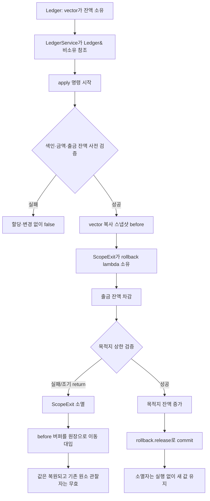

# 2026-10-16 Modern C++ 일일 학습

## 오늘의 주제

- 실무 Modern C++: **RAII 범위 종료 가드로 트랜잭션 rollback/commit 경계 만들기**
- 대회 알고리즘: **small-to-large 집합 병합**과 반복 후위 순회
- 표준 라이브러리: `std::unordered_set::merge`, `std::unique_ptr`, `std::vector`, 스트림 계약

현재 w64devkit GCC 16.1.0의 libstdc++에는 C++23 표준 `<scope>`가 아직 설치되어 있지 않다. 그래서
`main.cpp`와 `problem.cpp`는 비지원 API를 흉내 내어 `std` namespace에 넣지 않고, 원리를 눈으로 확인할
수 있는 최소 `ScopeExit<ExitFunction>`을 직접 구현한다. 호출 가능 객체를 값으로 소유하고 소멸자에서
rollback하며, `release()`가 commit하는 구조는 라이브러리 지원 환경의 `std::scope_exit`로 교체할 수 있다.

## 학습 목표

1. 생성자/소멸자 수명에 정리 동작을 묶는 RAII가 조기 `return`에서도 강한 상태 불변식을 지키는 이유를
   설명한다.
2. lvalue인 lambda 매개변수를 `std::move`로 xvalue로 바꾸는 단계와 실제 이동 생성을 구분한다.
3. `std::unordered_set::merge`가 key를 복사하지 않고 node 소유권을 옮기며, 중복 key는 source에 남긴다는
   계약을 적용한다.
4. 재귀 없이 부모-선행 순서를 만들고 역순으로 읽어 안전한 후위 처리를 구성한다.
5. small-to-large의 population doubling 불변식으로 평균 `O(n log n)`을 증명하고 해시 충돌 최악 상한과
   구분한다.
6. 표준 라이브러리 각 첫 호출을 수신 객체, overload, 인자, 반환, 사후 상태, 오류·수명까지 설명한다.

## 오늘의 ICPC 문제

| 항목 | 내용 |
|---|---|
| 문제 | **CSES 1139 — Distinct Colors** |
| 공식 출처 | [https://cses.fi/problemset/task/1139/](https://cses.fi/problemset/task/1139/) |
| 입력 규모 | `1 <= n <= 200,000`, 색과 정점 번호는 공식 범위 안의 정수, 입력 그래프는 루트 1의 트리 |
| 핵심 알고리즘 | 반복 FIFO worklist로 부모/순서 생성 → 역순 후위 처리 → population 기준 small-to-large hash-set node merge |
| 평균 시간 | `O(n log n)` — 정상적인 hash 분포를 가정한 전체 merge |
| 보수적 최악 시간 | `O(n^2)` — 표준이 허용하는 병적 hash 충돌까지 포함 |
| 공간 | `O(n)` — 인접 리스트, 배열, 살아 있는 색 node와 bag |
| 대표 문서 | [`../algorithm/small-to-large-set-merging.md`](../algorithm/small-to-large-set-merging.md) |

### 문제를 짧게 다시 말하기

정점 1이 루트인 트리에서 각 정점은 색 하나를 가진다. 정점 `v`마다 `v`와 모든 자손에게 나타나는 색의
종류 수를 정점 번호 순서대로 출력한다. 색 값 자체는 크므로 색 범위만큼 배열을 만들지 않고, 실제로
등장한 key만 집합 node로 소유한다.

### 핵심 불변식

- 부모-선행 `order`를 뒤에서 읽을 때 현재 정점의 모든 직접 자식 bag은 이미 완성되어 있다.
- 처리 중인 `current.colors`는 지금까지 합친 서로 겹치지 않는 정점 성분들의 색 합집합이다.
- `represented_nodes`는 서로 다른 색 수가 아니라 bag이 대표하는 **원래 정점 수**다.
- merge 전에 작은 population의 bag이 source가 되게 소유 포인터를 교환한다.
- 처리 완료 뒤 `current.colors.size()`는 정확히 현재 정점 서브트리의 distinct color 수다.

서로 다른 색 수만 무게로 쓰면 중복이 많은 입력에서 단순 doubling 증명이 흐려질 수 있다. 원래 정점 수를
무게로 쓰면 source에 속한 정보가 다시 source가 될 때마다 대표 population이 적어도 두 배가 된다. 평균
해시 모델에서 전체 key 검사 수는 `O(n log n)`이다. 표준의 `unordered_set` 연산은 최악 상수 시간을
보장하지 않으므로, 충돌까지 포함한 결정적 요구라면 `std::set`의 `O(n log^2 n)` 대안을 검토한다.

## 생성 파일

- [`README.md`](README.md): 오늘 학습 지도, 문제·복잡도·검증 요약
- [`CMakeLists.txt`](CMakeLists.txt): C++23 세 실행 파일과 strict warning/CTest 설정
- [`main.cpp`](main.cpp): `ScopeExit`를 이용한 계좌 이체 rollback/commit 실무 패턴
- [`problem.cpp`](problem.cpp): 두 단계 quota 차감으로 직접 연습하는 최소 예제
- [`CHECKPOINT.md`](CHECKPOINT.md): 초보자 설명·호출 계약·식 해석 검증 문제
- [`icpc_problem.cpp`](icpc_problem.cpp): CSES 1139 제출 가능한 완전한 풀이
- [`run_icpc_test.cmake`](run_icpc_test.cmake): 종료 코드와 전체 stdout을 비교하는 CTest helper

## `main.cpp` 구조도



핵심은 `before`가 `rollback`보다 먼저 선언된다는 점이다. 지역 객체는 선언의 역순으로 파괴되므로
`rollback` 소멸자가 lambda를 실행할 때 `before`와 `LedgerService`가 아직 살아 있다.

## 초보자를 위한 기초 문법 지도

### 기본 타입과 중괄호 초기화

- `int amount{}`는 `amount`를 0으로 값 초기화한다. 초기화하지 않은 기본 정수를 읽는 실수를 피한다.
- `std::size_t`는 컨테이너 크기와 인덱스를 표현하는 부호 없는 표준 별칭이다.
- `TransferCommand{0, 1, 30}`은 `struct`의 public 멤버를 선언 순서대로 초기화하는 prvalue 식이다.
- 중괄호 초기화는 위험한 narrowing 변환을 일반 괄호/대입보다 더 엄격하게 거부한다.

### 함수, 반환형, 매개변수와 `const`

- `bool apply(const TransferCommand& command)`에서 `bool`은 성공/실패 결과, `const ...&`는 명령을
  복사하거나 소유하지 않고 읽기만 하는 참조 매개변수다.
- `view() const`의 뒤 `const`는 `LedgerService`의 관찰 가능한 멤버 상태를 바꾸지 않는 함수라는 뜻이다.
- `[[nodiscard]]`는 중요한 반환값을 호출자가 버릴 때 진단을 요청한다.
- `noexcept`는 함수 밖으로 예외가 나가지 않는다는 타입 계약이며, 무조건 “실패할 수 없다”는 뜻은 아니다.

### 포인터와 참조

- `Ledger&`는 기존 객체에 한 번 결합하는 null 불가 비소유 별칭이다. 원장의 수명을 늘리지는 않는다.
- lambda가 캡처한 `this`는 `LedgerService*` 포인터다. 포인터는 주소 값이며 소유권을 갖지 않는다.
- `std::unique_ptr<ColorBag>`은 반대로 heap 객체 하나의 파괴 책임을 가진다. `operator->`가 주는 raw
  pointer는 잠시 관찰할 뿐 그 책임을 가져오지 않는다.
- 비소유 참조/포인터는 반드시 owner보다 먼저 사용을 끝내야 한다.

### `struct`, `class`, 접근 지정자와 생성자

- `struct`의 기본 접근은 `public`, `class`는 `private`다. 둘 다 멤버 함수·생성자·template을 가질 수 있다.
- `explicit LedgerService(Ledger&)`는 `Ledger`가 뜻하지 않게 서비스 객체로 암시 변환되는 것을 막는다.
- `: ledger_{ledger}`는 생성자 본문에 들어가기 전에 참조 멤버를 결합하는 멤버 초기화 목록이다.
- `template<class ExitFunction>`의 template 인자는 저장할 lambda의 컴파일 시간 타입이다. CTAD가
  `ScopeExit rollback{lambda};`에서 그 타입을 추론한다.

### 제어문

- `if`는 검증 실패를 조기에 반환한다. `||`와 `&&`는 왼쪽부터 단락 평가한다.
- `for`는 초기화 → 조건 비교 → 본문 → 증감 순서로 반복한다.
- ICPC 풀이의 `continue`는 현재 이웃만 건너뛰고 다음 이웃으로 진행한다.
- `condition ? 0 : 1`은 조건에 따라 두 결과식 중 하나만 평가한다.

## Modern C++ 심화: 식과 객체 수명

### lvalue, prvalue, xvalue

- 이름 있는 `before`, `current`, `colors[index]`는 저장 위치가 식별되는 lvalue다.
- `TransferCommand{...}`와 `std::make_unique<ColorBag>(...)`의 반환 값은 prvalue다.
- `std::move(before)`는 객체를 즉시 옮기지 않는다. 같은 객체를 가리키는 xvalue 참조를 만들어 뒤의
  `vector` 이동 대입이 버퍼 소유권을 가져갈 수 있게 한다.

### 참조 바인딩, 복사와 이동

- 명령 prvalue는 `const TransferCommand&`에 full-expression 끝까지 안전하게 바인딩된다.
- rollback 준비 시 `std::vector<int> before{ledger_.balances}`는 독립 스냅샷을 **복사**한다.
- 실패 시 `ledger_.balances = std::move(before)`는 기본 allocator가 같은 vector의 버퍼를 **이동**한다.
- ICPC 풀이의 `unique_ptr::swap`과 이동 대입은 `ColorBag`/hash node를 복사하지 않고 파괴 책임만 바꾼다.

### 객체 수명, 소유권과 복사 생략

- `ScopeExit`는 lambda를 값으로 소유하며 함수 scope 끝까지 active 상태를 기억한다.
- rollback lambda의 참조/포인터 캡처 대상은 guard 소멸 시점까지 살아 있어야 한다.
- `make_unique`가 반환한 prvalue는 `current` 결과 객체를 직접 초기화한다. 불필요한 같은 타입 임시
  복사/이동이 없는 C++17 이후 보장 복사 생략이며, 이름 있는 local의 선택적 NRVO와 구분한다.
- `unordered_set::merge`로 이전된 원소의 pointer/reference는 같은 원소를 계속 가리키지만 그 원소의
  소유 컨테이너는 destination이 된다. source에 남은 중복 원소는 `reset()`에서 파괴된다.

## 기계 실행 관점

소스의 대입은 메모리 load/store, 범위 검사는 비교와 조건 분기, `vector` 순회는 연속 주소 계산으로
구현될 수 있다. `unordered_set`은 hash 계산 뒤 bucket과 node pointer를 간접 load하고, node 이전 시
연결 pointer를 store할 수 있다. 오늘 타입에는 virtual 함수가 없어 virtual 간접 호출을 요구하지 않는다.
그러나 인라이닝, 분기 제거, 실제 명령 수, cache miss, allocator 호출과 buffer flush는 CPU, ABI,
표준 라이브러리 구현, 컴파일러 버전과 최적화 옵션에 따라 달라진다. 소스만 보고 특정 어셈블리 한 형태로
단정하지 않는다.

## 오늘 사용한 표준 라이브러리

| 핵심 심볼 | 선언 헤더 | 항목 종류 | 실제 호출 멤버/함수 | 현재 코드에서의 역할 | 대표 문서 |
|---|---|---|---|---|---|
| `std::vector` | `<vector>` | class template | 생성자, `operator[]`, `size`, `reserve`, `push_back`, 이동 대입 | 원장, 그래프, 부모, 순서, 답과 bag owner 배열 | [`containers-and-views.md`](../standard-library/containers-and-views.md) |
| `std::unordered_set` | `<unordered_set>` | 해시 연관 class template | 기본 생성, `insert`, `merge`, `size` | 서브트리의 서로 다른 색 node를 소유하고 작은 bag을 큰 bag으로 이전 | [`containers-and-views.md`](../standard-library/containers-and-views.md) |
| `std::unique_ptr`, `std::make_unique` | `<memory>` | class/function template | `make_unique`, `operator->`, `swap`, `reset`, 이동 대입 | `ColorBag`의 단독 소유와 소비 시점 표현 | [`ownership-and-vocabulary-types.md`](../standard-library/ownership-and-vocabulary-types.md) |
| `std::move` | `<utility>` | 함수 template | `move(callable)`, `move(vector)`, `move(unique_ptr)` | lvalue를 xvalue로 표시해 다음 이동 연산이 소유권을 넘기게 함 | [`io-parsing-and-utilities.md`](../standard-library/io-parsing-and-utilities.md) |
| `std::allocator` | `<memory>` | 기본 allocator class template | vector/unordered_set의 숨은 기본 template 인자 | 동적 저장소 획득·해제 정책 | [`containers-and-views.md`](../standard-library/containers-and-views.md) |
| `std::size_t` | `<cstddef>` | 부호 없는 정수 타입 별칭 | 크기/인덱스 값과 반환형 | 컨테이너 크기, cursor, 정점 수 무게 표현 | [`bit-and-byte-utilities.md`](../standard-library/bit-and-byte-utilities.md) |
| `std::cin`, `std::cout`, `std::ostream`, `std::ios::sync_with_stdio` | `<iostream>` | 객체·타입·정적 함수 | `tie`, `operator>>`, `operator<<`, `sync_with_stdio` | 빠른 입력, 파싱 상태와 정답 출력 | [`io-parsing-and-utilities.md`](../standard-library/io-parsing-and-utilities.md) |

감사와 복습에서 쓰는 정확한 첫 호출 표기는 다음과 같다: `std::move(`, `sync_with_stdio(`,
`std::cin.tie(`, `std::cin >>`, `basic_ios::operator!`, `std::cout <<`,
`operator<<(std::ostream&, char)`, vector의 `기본 생성자`, `initializer-list 생성자`, `count 생성자`,
`fill 생성자`, `vector::operator[]`, `vector::reserve`, `vector::push_back`, `vector::size`.

## 직접 해보기

1. `main.cpp`에서 두 번째 명령 금액을 `40`으로 바꾸고 목적지 상한 검사·출력·잔액을 실행 전에 예측한다.
2. `rollback.release()`를 주석 처리해 성공 경로도 복구되는지 확인하고 RAII 상태 전이를 설명한다.
3. `ScopeExit`보다 `before`를 늦게 선언할 수 없는 이유를 파괴 역순으로 그린다.
4. `problem.cpp`의 두 번째 요청을 `(2, 1)`로 바꿔 commit되는 결과를 예측한다.
5. ICPC 풀이에서 population 비교 방향을 뒤집은 뒤 사슬/별 트리의 작업량 차이를 설명한다.
6. `unordered_set`을 `std::set`으로 바꾸고 평균/최악 복잡도와 iterator/할당 특성을 비교한다.
7. 재귀 DFS로 바꾼 버전이 `n=200000` 사슬에서 가질 수 있는 실행 환경 의존 위험을 설명한다.

## 검증 과정

다음 순서로 검증한다.

1. 세 C++ 파일을 GCC 16.1.0, C++23, `-Wall -Wextra -Wpedantic -Wconversion -Wshadow -Werror`,
   `_GLIBCXX_ASSERTIONS`로 빌드한다.
2. CMake 기반 Release 빌드 뒤 CTest의 공식 예제·단일 정점·중복 사슬·서로 다른 색 별·혼합 트리와
   두 학습 실행 파일 출력을 전부 비교한다.
3. 작은 무작위 트리를 독립적인 서브트리 완전 탐색 oracle과 대조한다.
4. 최대 `n=200000` 사슬/별 입력으로 재귀 스택 부재와 시간·메모리 동작을 확인한다.
5. 공용 표준 라이브러리 문서 감사를 `-Scope all`로 실행한다.

재현 명령:

```powershell
$kit = (Resolve-Path tools/w64devkit/bin).Path
$env:Path = "$kit;$env:Path"
cmake -S dailystudy/exercise/2026-10-16 -B build/daily-2026-10-16 -G "MinGW Makefiles" -DCMAKE_BUILD_TYPE=Release "-DCMAKE_CXX_COMPILER=g++.exe"
cmake --build build/daily-2026-10-16 --parallel
ctest --test-dir build/daily-2026-10-16 --output-on-failure
powershell -ExecutionPolicy Bypass -File dailystudy/exercise/tools/audit-standard-library-docs.ps1 -Scope all
```

최종 결과:

- Release 빌드와 CTest **7/7** 통과
- 독립 완전 탐색 oracle과 작은 무작위 트리 **400/400** 일치
- 최대 입력 stress: 동일 색 사슬 `n=200000` 약 **0.134초**, 모두 다른 색 별 `n=200000` 약 **0.179초**
  (이 수치는 이번 로컬 실행의 관측값이며 하드웨어·운영체제·컴파일러에 따라 달라진다.)
- 알고리즘 대표 문서의 C++20 뼈대 strict 구문 검사 통과
- 표준 라이브러리 문서 감사 `latest`와 `all` 통과
  (`all`: 날짜 72개, C++ 파일 197개, 심볼 190개, 헤더 58개, 멤버 59개, 연산 후보 5개)
