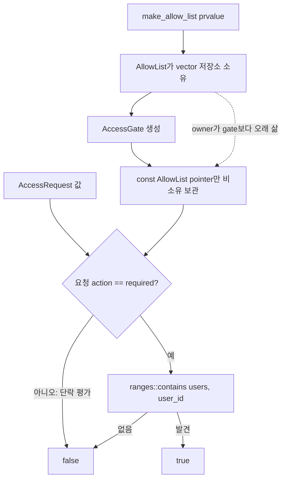

# 2026-10-19 — `std::ranges::contains` 정책 경계와 SCC 압축 DAG DP

## 오늘의 주제

- 실무 Modern C++: 소유 `AllowList`와 비소유 `AccessGate`를 분리하고 C++23
  `std::ranges::contains`로 정책 의도를 표현한다.
- 대회 알고리즘: **반복형 Kosaraju SCC → 압축 DAG → 위상 순서 최장 경로 DP**
- 표준 라이브러리: 범위 알고리즘, `std::vector` 소유권·무효화, 스트림 호출 계약

`ranges::contains`는 단순 선형 검색이지만, 서비스에 반복자를 노출하거나 sentinel 값으로 실패를
표현하지 않고 `bool` 질의로 업무 의도를 고정한다. 오늘 예제에서는 목록 owner가 저장소 수명을 맡고,
서비스는 owner보다 짧게 사는 `const AllowList*`만 보관한다. `main.cpp`는 owner 자체도 `const`로
선언해 정책 스냅숏을 사용하는 동안 대입·구조 변경과 관찰자 무효화를 막는다. 일반 non-const
`AllowList`까지 타입 수준에서 불변인 것은 아니므로 공유 사용자는 owner의 const/동기화 정책을 지켜야 한다.

## 학습 목표

1. `struct`/`class`, 접근 지정자, `explicit`, 멤버 초기화 목록, `using`, template 인자를 초보자 말로
   설명한다.
2. lvalue·prvalue·xvalue, 참조 바인딩, 복사·이동, 소유권·수명, 보장 복사 생략과 NRVO의 차이를
   실제 식에서 판별한다.
3. `ranges::contains`의 range/value/projection 인자, bool 반환, 선형 복잡도, 무효화·예외·동시성
   계약을 말한다.
4. SCC 내부의 모든 동전을 하나로 합쳐도 되는 이유와 압축 그래프가 DAG인 이유를 증명한다.
5. 재귀 호출 스택 없이 DFS 종료 시점을 명시적 frame으로 표현한다.
6. 중복 압축 간선을 제거하지 않아도 진입 차수와 완화가 정확한 이유를 설명한다.

## 오늘의 ICPC 문제

| 항목 | 내용 |
|---|---|
| 문제 | **CSES 1686 — Coin Collector** |
| 공식 출처 | [https://cses.fi/problemset/task/1686/](https://cses.fi/problemset/task/1686/) |
| 입력 규모 | `1 <= n <= 100,000`, `1 <= m <= 200,000`, `1 <= k_i <= 10^9` |
| 핵심 알고리즘 | 반복형 Kosaraju SCC, SCC별 가중치 합, 압축 DAG Kahn 위상 DP |
| 시간 | `O(n+m)` |
| 추가 공간 | `O(n+m)` |
| 대표 문서 | [`../algorithm/strongly-connected-components-kosaraju.md`](../algorithm/strongly-connected-components-kosaraju.md) |

### 문제를 짧게 다시 말하기

각 방에 동전이 있고 단방향 터널을 따라 이동한다. 시작과 끝은 자유다. 한 walk(정점을 다시 방문할 수
있는 이동 순서)에서 방문 가능한 방들의
동전 합을 최대화한다. 방향 사이클 안에서는 어느 방에서든 다른 모든 방으로 갔다가 필요한 출구로 나갈
수 있으므로 SCC 하나를 “동전 합을 가진 압축 정점”으로 바꾼다. 그 뒤에는 사이클이 없는 그래프에서
최대 가중 경로를 구하면 된다.

### 핵심 불변식과 우승 포인트

- 첫 DFS의 frame `(vertex,next_edge)`는 현재 정점에서 이미 검사한 간선 경계를 기억한다. 모든 간선을
  처리한 뒤에만 `order`에 넣으므로 재귀 DFS와 같은 종료 순서를 만든다.
- 종료 순서를 거꾸로 읽어 역그래프를 탐색하면 탐색 하나가 정확히 하나의 아직 미배정 SCC만 모은다.
- 같은 SCC 안의 정점은 상호 도달 가능하다. 동전이 모두 양수이므로 그 SCC를 방문한 최적 이동은 내부
  모든 방의 동전을 얻도록 walk를 늘려도 손해가 없다. 이 과정에서 정점을 다시 방문할 수 있다.
- 서로 다른 SCC 사이에 방향 사이클이 있다면 그 SCC들은 사실 상호 도달 가능하여 하나의 SCC여야 한다.
  따라서 압축 그래프는 DAG다.
- `best[c]`는 처리 시점까지 발견한 “컴포넌트 c에서 끝나는 최대 동전 합”이다. 진입 차수가 0이 되는
  순간 모든 선행 컴포넌트가 완화되었으므로 값이 확정된다.
- SCC 쌍 사이 중복 간선은 각각 진입 차수를 올리고 각각 한 번 감소한다. 같은 후보를 여러 번 비교해도
  `max` 의미는 바뀌지 않아 정확성은 유지되며, 전체 처리량은 원래 간선 수 `m` 안이다.
- 최대 합은 `100,000 * 10^9 = 10^14`이므로 32-bit `int`가 아니라 64-bit 정수가 필요하다.

## 생성 파일

- [`README.md`](README.md): 오늘의 학습 지도, 문제·복잡도·검증 기록
- [`CMakeLists.txt`](CMakeLists.txt): C++23 strict build와 정확 출력 CTest
- [`main.cpp`](main.cpp): 소유 allow-list와 비소유 접근 정책 서비스
- [`problem.cpp`](problem.cpp): 재시도 HTTP 상태 코드 정책 연습
- [`CHECKPOINT.md`](CHECKPOINT.md): 초보자 설명·식 해석·계약 검증 문제
- [`icpc_problem.cpp`](icpc_problem.cpp): CSES에 제출 가능한 반복형 SCC + DAG DP 풀이
- [`run_icpc_test.cmake`](run_icpc_test.cmake): 종료 코드와 stdout 전체 비교 helper

## `main.cpp` 구조도



`AllowList`가 먼저 선언되고 `AccessGate`가 나중에 선언된다. 지역 객체는 역순으로 파괴되므로 gate가
먼저 사라지고 allow-list 저장소가 나중에 사라진다. 따라서 gate의 비소유 pointer가 댕글링하는 사용
구간이 생기지 않는다.

## 초보자를 위한 기초 문법 지도

### `#include`, 기본 타입과 중괄호 초기화

- `<algorithm>`은 `ranges::contains`, `<vector>`는 동적 배열, `<utility>`는 이동 표현,
  `<iostream>`은 표준 출력을 각각 선언한다. 간접 include에 기대지 않고 쓰는 기능의 헤더를 직접 넣는다.
- `int`는 사용자 ID·상태 코드처럼 이 예제 범위의 정수를, `bool`은 허용/거부 두 상태를 나타낸다.
- `UserId user_id{};`는 기본 정수를 0으로 값 초기화한다. 초기화되지 않은 지역 정수를 읽는 오류를
  예방한다.
- `AccessRequest{42, Action::deploy}`는 멤버 선언 순서로 값을 넣어 임시 요청 객체를 만드는 prvalue다.

### 함수, 반환형, 매개변수와 `const`

- `bool authorize(const AccessRequest& request) const`의 앞 `bool`은 반환형이다. 매개변수의 `const&`는
  요청을 복사·소유하지 않고 읽기만 한다. 뒤 `const`는 서비스의 관찰 가능한 상태를 바꾸지 않는다.
- `[[nodiscard]]`는 중요한 허용/거부 결과를 호출자가 버릴 때 진단을 요청한다.
- `noexcept`는 함수 밖으로 예외가 나오지 않는다는 계약이다. 모든 논리 실패가 불가능하다는 뜻은 아니다.

### 포인터, 참조와 수명

- `const AllowList&`는 null일 수 없는 읽기 전용 비소유 별칭이다. 생성자 안에서 그 주소를 얻는다.
- `const AllowList*`는 주소 값이며 파괴 책임이 없다. pointer 자체는 null 표현이 가능하지만 오늘
  생성자는 유효한 참조만 받아 non-null 불변식을 세운다.
- 참조나 pointer는 owner 수명을 늘리지 않는다. owner가 먼저 파괴되면 역참조는 미정의 동작이 된다.

### `struct`, `class`, 접근 지정자, 생성자와 별칭

- `struct`의 기본 접근은 `public`, `class`의 기본 접근은 `private`다. 둘 다 데이터·함수·생성자를
  가질 수 있고 차이는 기본 접근뿐이다.
- `public`에는 호출자가 써도 되는 생성·조회 API를, `private`에는 직접 깨뜨리면 안 되는 저장소와
  비소유 pointer를 둔다.
- `explicit AllowList(vector)`는 vector가 뜻하지 않게 정책 객체로 암시 변환되는 것을 막는다.
- `: users_{std::move(users)}`는 생성자 본문 전에 멤버를 만들며 실제 초기화 순서는 멤버 선언 순서다.
- `using UserId = int`는 새 강한 타입이 아니라 별칭이다. 반대로 `enum class Action`은 별도 타입이다.
- `std::vector<UserId>`의 template 인자 `UserId`는 원소 타입이다. allocator 인자는 기본값을 쓴다.

### 제어문

- `left && right`는 왼쪽이 false면 오른쪽을 평가하지 않는 단락 평가다. 잘못된 action이면 목록 검색도
  수행하지 않는다.
- `for`는 초기화 → 조건 비교 → 본문 → 증감 순서로 반복한다.
- `if`는 비교 결과에 따라 조건 분기를 만든다. `continue`는 현재 반복만 건너뛴다.
- 온라인 저지 풀이의 `while (!stack.empty())`는 명시적 DFS stack에 frame이 있는 동안 반복한다.

## Modern C++ 심화: 식, 이동, 수명과 아키텍처

### lvalue, prvalue, xvalue와 참조 바인딩

- 이름 있는 `users`, `allow_list`, `request`, `coins[index]`는 저장 위치가 식별되는 lvalue다.
- `AccessRequest{...}`, `std::vector<UserId>{...}`, 함수가 직접 반환하는 `AllowList{...}`는 prvalue다.
- `std::move(users)`는 이름 있는 lvalue를 같은 객체를 가리키는 xvalue로 바꾼다. 함수 자체가 버퍼를
  옮기는 것이 아니라 뒤에 선택된 vector 이동 생성자가 소유권을 넘긴다.
- 요청 prvalue는 `const AccessRequest&`에 그 함수 호출 full-expression이 끝날 때까지 안전하게 결합된다.

### 복사·이동, 객체 수명과 복사 생략

- lvalue vector를 `AllowList` 값 매개변수에 넘기면 매개변수 구성에서 복사되고, rvalue를 넘기면
  이동되거나 직접 구성될 수 있다. 매개변수에서 멤버로는 명시적으로 이동한다.
- 이동 뒤 원본 vector는 파괴 가능한 유효 상태지만 내용은 미지정이다. `empty()`라고 가정하지 않는다.
- `return AllowList{...};`의 prvalue는 호출자의 결과 객체를 직접 초기화한다. 이는 보장 복사 생략이며,
  이름 있는 지역 변수 반환에서 허용되지만 의무는 아닌 NRVO와 구분한다.
- `AccessGate`는 목록을 소유하지 않으므로 복사 비용은 작지만 owner보다 오래 살 수 없다는 수명 계약을
  API 사용 순서가 보장해야 한다. 장기 비동기 저장이 필요하면 소유 모델을 다시 선택한다.

### 아키텍처 역할

`AllowList`는 저장·수명·검색 정책을 캡슐화한 owner다. `AccessGate`는 action 검사와 allow-list 질의를
조합하는 application service다. 컨테이너를 직접 반환하지 않아 호출자가 반복자를 장기 보관하거나
목록을 몰래 수정하지 못한다. 조회가 매우 많고 목록이 크다면 정렬 vector+binary search나 hash set으로
교체할 수 있으며, public 서비스 계약은 그대로 유지할 수 있다.

## 기계 실행 관점

vector 기반 `ranges::contains`는 원소 주소 계산과 load, 정수 비교, 일치/끝 조건 분기를 만들 수 있다.
pointer 멤버를 통한 owner 접근은 주소 load를 포함할 수 있고, DFS/DP는 인접 리스트 pointer load와
64-bit 덧셈·비교·store를 유도할 수 있다. 오늘 클래스에는 virtual 함수가 없어 가상 간접 호출이
필수는 아니다. 그러나 실제 명령 수, inlining, 분기 제거·예측, 벡터화, cache miss, allocator 호출은
CPU, ABI, 컴파일러, 표준 라이브러리 구현과 최적화 옵션에 따라 달라 특정 어셈블리로 단정하지 않는다.

## 오늘 사용한 표준 라이브러리

| 핵심 심볼 | 선언 헤더 | 항목 종류 | 실제 호출 멤버/함수 | 현재 코드에서의 역할 | 대표 문서 |
|---|---|---|---|---|---|
| `std::ranges::contains` | `<algorithm>` | niebloid range algorithm | `std::ranges::contains(range, value)` | 소유 정책 목록을 수정하지 않고 ID·상태 코드 존재 여부를 bool로 반환 | [`algorithms-and-ranges.md`](../standard-library/algorithms-and-ranges.md) |
| `std::vector<T>` | `<vector>` | class template | 기본/initializer-list/count/fill/copy/move 생성자, `operator[]`, `reserve`, `push_back`, `size`, `empty`, `back`, `pop_back` | 정책 저장소, 그래프, 명시적 DFS stack, SCC/DP 배열 소유 | [`containers-and-views.md`](../standard-library/containers-and-views.md) |
| `std::move` | `<utility>` | function template | `std::move(users)` | 이름 있는 값 매개변수를 xvalue로 표시해 vector 멤버 이동 생성을 허용 | [`io-parsing-and-utilities.md`](../standard-library/io-parsing-and-utilities.md) |
| `std::size_t`, `std::int64_t` | `<cstddef>`, `<cstdint>` | 기본 정수 type alias | 산술·비교·색인·누적 | 컨테이너 크기/정점과 최대 `10^14` 동전 합 표현 | [`bit-and-byte-utilities.md`](../standard-library/bit-and-byte-utilities.md) |
| `std::cin`, `std::istream` | `<iostream>` | 표준 객체·stream class | `sync_with_stdio`, `tie`, `operator>>` | 빠른 공식 입력 파싱과 스트림 상태 보존 | [`io-parsing-and-utilities.md`](../standard-library/io-parsing-and-utilities.md) |
| `std::cout`, `std::ostream` | `<iostream>` | 표준 객체·stream class | 정수/bool/char `operator<<` | 학습 결과와 정답을 순서대로 출력 | [`io-parsing-and-utilities.md`](../standard-library/io-parsing-and-utilities.md) |
| `std::allocator<T>`, `std::identity` | `<memory>`, `<functional>` | 기본 allocator·projection function object | vector의 숨은 기본 allocator, contains의 생략된 projection | 소유 저장소 획득과 원소 자체 비교 정책 | [`containers-and-views.md`](../standard-library/containers-and-views.md), [`algorithms-and-ranges.md`](../standard-library/algorithms-and-ranges.md) |

감사와 복습에 쓰는 첫 호출 표기는 다음과 같다: `std::ranges::contains(`, `std::move(`,
`sync_with_stdio(`, `std::cin.tie(`, `std::cin >>`, `std::cout <<`,
`operator<<(std::ostream&, char)`, vector의 `기본 생성자`, `initializer-list 생성자`, `count 생성자`,
`fill 생성자`, `copy 생성자`, `move 생성자`, `vector::operator[]`, `vector::reserve`,
`vector::push_back`, `vector::size`, `vector::empty`, `vector::back`, `vector::pop_back`.

## 직접 해보기

1. `main.cpp`의 허용 ID에서 `42`를 제거하고 세 출력값을 실행 전에 예측한다.
2. `AccessGate`를 allow-list보다 먼저 선언할 수 없는 이유를 파괴 역순과 pointer 수명으로 설명한다.
3. `AllowList` 생성자의 `std::move`를 제거해 복사 가능 여부와 추가 비용을 관찰한다.
4. `ranges::contains`에 projection을 추가해 `struct User{UserId id;}` 목록을 ID로 검색한다.
5. 정책 목록이 백만 개이고 조회가 반복될 때 선형 vector, 정렬 vector, hash set의 trade-off를 적는다.
6. `icpc_problem.cpp`의 종료 시점 `order.push_back(vertex)`를 발견 시점으로 옮긴 반례를 만든다.
7. 압축 간선 중복을 정렬·제거하는 버전을 만들고 시간·메모리·코드 복잡도를 비교한다.
8. 모든 방이 한 SCC인 경우와 모두 DAG인 경우의 component 수, DP 초기값, 답을 손으로 추적한다.

## 검증 과정

1. 세 C++ 소스를 GCC 16.1.0, C++23, `-Wall -Wextra -Wpedantic -Wconversion -Wshadow
   -Werror`, `_GLIBCXX_ASSERTIONS`로 빌드한다.
2. CMake Release build와 CTest로 두 학습 출력, 공식 예제, 단일 방, 단일 SCC, 분기 DAG,
   중복 압축 간선, 64-bit 합계를 정확 비교한다.
3. 작은 무작위 방향 그래프를 독립적인 도달 가능성 기반 SCC/oracle과 대조한다.
4. 최대 `n=100000`, `m=200000` 형태를 실행해 재귀 stack 비의존성과 선형 메모리를 확인한다.
5. 날짜 폴더 C++를 다시 읽고 알고리즘 링크, 6요소 호출 계약, UTF-8/마지막 LF를 점검한다.
6. 공용 문서 감사 스크립트를 `-Scope all`로 실행한다.

재현 명령:

```powershell
$toolBin = (Resolve-Path tools/w64devkit/bin).Path
$env:Path = "$toolBin;$env:Path"
& "$toolBin/cmake.exe" -S dailystudy/exercise/2026-10-19 -B build/daily-2026-10-19 -G "MinGW Makefiles" -DCMAKE_BUILD_TYPE=Release "-DCMAKE_CXX_COMPILER=$toolBin/g++.exe" "-DCMAKE_MAKE_PROGRAM=$toolBin/mingw32-make.exe"
& "$toolBin/cmake.exe" --build build/daily-2026-10-19 --parallel
& "$toolBin/ctest.exe" --test-dir build/daily-2026-10-19 --output-on-failure
powershell -ExecutionPolicy Bypass -File dailystudy/exercise/tools/audit-standard-library-docs.ps1 -Scope all
```

최종 검증 결과:

- w64devkit GCC 16.1.0 C++23 Release 엄격 빌드와 CTest **8/8**이 통과했다.
- 서로 독립인 두 검증에서 고정/무작위 작은 그래프 **504개**와 추가 무작위 그래프 **1,200개**를
  도달 가능성 기반 oracle과 대조했다. 최대 `n=100,000`, `m=200,000` 두 형태도 통과했고 최대 합
  `10^14`를 보존했다.
- SCC 문서와 `ranges::contains` 문서의 C++ 예제를 엄격 옵션으로 컴파일·실행했고, Mermaid 구조도
  렌더링과 변경 문서의 상대 링크 **371개**를 확인했다.
- 의도한 파일 **13개**가 UTF-8, 마지막 LF, trailing whitespace 없음 조건을 만족했다.
- 표준 라이브러리 감사의 latest/all 범위가 모두 통과했다. 전체 기준은 날짜 **73개**, C++ 파일
  **200개**, 문서화 심볼 **192개**, 헤더 **58개**, 멤버 **59개**, 연산군 **5개**다.
