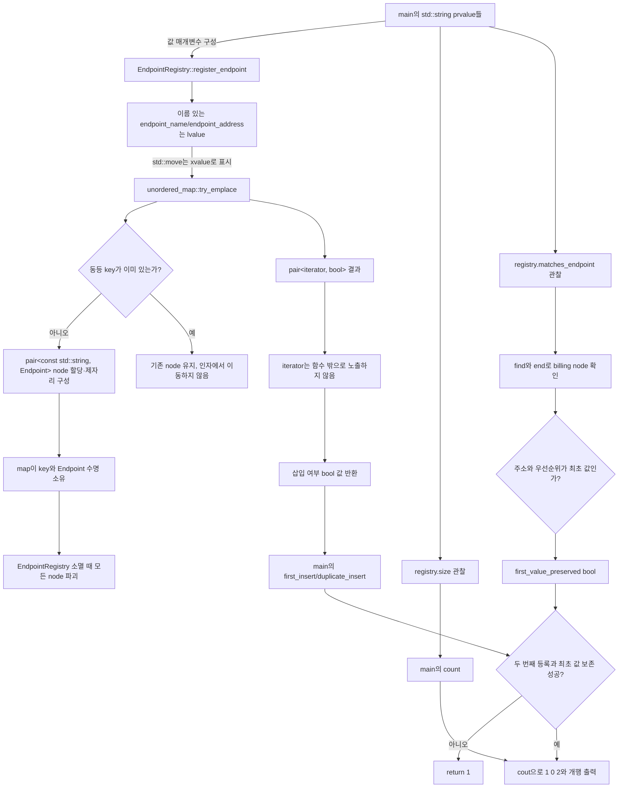

# 2026-10-20 — `try_emplace` 멱등 레지스트리와 트리 센트로이드

## 오늘의 주제

- 실무 Modern C++: **`std::unordered_map::try_emplace`로 중복 등록이 기존 값을 덮어쓰지 않는 레지스트리 경계 만들기**
- 대회 알고리즘: **반복 DFS, 부분 트리 크기, 트리 센트로이드**
- 핵심 수명 모델: 문자열과 hash node는 레지스트리가 소유하고, 반환 결과는 iterator를 밖으로 노출하지 않는 값 스냅숏이다.

`try_emplace`는 같은 key가 없을 때만 `mapped_type`을 제자리 구성한다. 같은 key가 있으면 기존 원소를
보존하며 key와 mapped 생성자 인자에서 이동하지 않는다. 다만 **함수 인자 식 자체는 호출 전에 평가**된다.
따라서 비싼 factory 호출을 인자로 쓰면 중복 key여도 factory는 실행된다. 오늘 코드는 이미 준비된 문자열과
작은 정수만 전달하고, 정말 지연 생성이 필요할 때는 먼저 `find`한 뒤 factory를 호출하는 별도 설계를 택한다.

## 학습 목표

1. `struct`와 `class`, 접근 지정자, `explicit`, 멤버 초기화 목록, `using`, template 인자를 초보자 말로 설명한다.
2. 값 매개변수의 복사/이동 선택과 `std::move`가 만드는 xvalue, 실제 이동 생성이 일어나는 지점을 구분한다.
3. `try_emplace`의 선택된 overload, 반환 `pair<iterator, bool>`, 중복/삽입 사후 상태를 정확히 말한다.
4. 평균 `O(1)`과 충돌 최악 `O(n)`, rehash 때 iterator 무효화와 pointer/reference 안정성을 구분한다.
5. 반복 DFS로 부모-선행 순서를 만들고 역순으로 부분 트리 크기를 계산해 센트로이드를 `O(n)`에 찾는다.
6. 표준 라이브러리의 첫 호출마다 수신 객체, overload, 인자, 반환, 사후 상태, 오류·수명·thread 계약을 검증한다.

## 오늘의 ICPC 문제

| 항목 | 내용 |
|---|---|
| 문제 | **CSES 2079 — Finding a Centroid** |
| 공식 출처 | [https://cses.fi/problemset/task/2079/](https://cses.fi/problemset/task/2079/) |
| 입력 규모 | `1 <= n <= 200,000`, 무방향 트리의 간선 `n-1`개 |
| 핵심 알고리즘 | 반복 DFS로 `parent`와 부모-선행 `order` 생성 → 역순 부분 트리 크기 → 가장 큰 분할 조각 검사 |
| 시간 복잡도 | `O(n)` |
| 추가 공간 | `O(n)` — 인접 리스트, 부모·순서·부분 트리 배열, 명시적 stack |
| 대표 문서 | [`../algorithm/centroid-decomposition-fixed-distance-pairs.md`](../algorithm/centroid-decomposition-fixed-distance-pairs.md) |

### 문제를 짧게 다시 말하기

트리에서 한 정점을 루트로 정했을 때 그 정점의 각 자식 부분 트리가 모두 `floor(n/2)`개 이하가 되는
정점 하나를 출력한다. 이 정점은 트리에서 제거했을 때 생기는 모든 연결 성분의 크기가 전체의 절반 이하인
**센트로이드**와 같다. 답이 둘이면 어느 쪽을 출력해도 되지만, 오늘 구현은 순회 순서에 따라 결정적인 한
정점을 출력해 CTest가 stdout 전체를 비교할 수 있게 한다.

### 핵심 불변식과 우승 포인트

- `order`에는 부모가 자식보다 먼저 들어간다. 역순으로 읽으면 자식의 `subtree_size`가 먼저 완성된다.
- 정점 `v`를 제거한 뒤 생기는 조각은 각 DFS 자식 부분 트리와 부모 방향 나머지 `n-subtree_size[v]`뿐이다.
- 위 조각들의 최댓값이 `n/2` 이하인 정점이 정확히 센트로이드다.
- 모든 인접 정점을 다시 세는 `O(n^2)` 구현 대신, 각 간선을 부모 작성 DFS와 후보 조각 검사에서
  상수 번만 읽는다. 역순 누적은 `order`·`parent`·`subtree_size` 배열만 읽는다.
- 재귀 DFS는 깊이 `200,000` 사슬에서 실행 환경의 호출 stack 한계를 넘을 수 있으므로 명시적 vector stack을 쓴다.
- 합과 크기는 최대 `200,000`이라 `std::size_t`에 안전하지만, 1-based 입력을 0-based로 바꾸기 전에 공식 범위를 전제한다.

## 생성 파일

- [`README.md`](README.md): 오늘 학습 지도, 문제·복잡도·검증 요약
- [`CMakeLists.txt`](CMakeLists.txt): C++23 세 실행 파일, 엄격 경고, CTest 설정
- [`main.cpp`](main.cpp): 서비스 endpoint의 최초 등록만 허용하는 멱등 레지스트리
- [`problem.cpp`](problem.cpp): 작업 종류별 실행 정책을 최초 한 번만 등록하는 연습 예제
- [`CHECKPOINT.md`](CHECKPOINT.md): 기초 문법, 호출 계약, 식 해석, 알고리즘 증명 문제
- [`icpc_problem.cpp`](icpc_problem.cpp): CSES 2079에 제출 가능한 반복형 완전 풀이
- [`run_icpc_test.cmake`](run_icpc_test.cmake): 종료 코드와 전체 stdout을 비교하는 CTest helper

## `main.cpp` 구조도



`EndpointRegistry`가 hash table node의 유일한 owner다. 함수 안의 iterator는 rehash 전에만 쓰고 밖으로
반환하지 않는다. `matches_endpoint`도 찾은 원소를 함수 안에서만 읽어 최초 설정 보존을 검증한다. 등록
여부 `bool`과 `size()`의 `std::size_t`는 독립 값이어서 registry보다 오래 살아도 dangling이 되지 않는다.

## 초보자를 위한 기초 문법 지도

### `#include`, 기본 타입과 중괄호 초기화

- `<unordered_map>`은 key로 값을 찾는 hash 연관 컨테이너, `<string>`은 문자 저장소를 소유하는 문자열,
  `<utility>`는 `std::move`와 `std::pair`, `<vector>`는 연속 동적 배열, `<iostream>`은 표준 입출력을 선언한다.
- `EndpointPriority priority{}`와 `RetryLimit retry_limit{}`은 기본 `int`를 `0`으로 값 초기화한다.
- ICPC의 `Vertex vertex_count{}`도 기본 `int`를 0으로 만든다. 중괄호 초기화는 `double`에서 `int` 같은 narrowing을 더 엄격히 막는다.
- `std::size_t`는 컨테이너 크기와 색인에 쓰는 부호 없는 표준 정수 별칭이다.

### 함수, 반환형, 매개변수와 `const`

- `bool register_endpoint(std::string endpoint_name, ...)`에서 앞 타입은 반환형, 괄호 안은
  매개변수다. 문자열을 값으로 받아 호출자가 lvalue면 복사, rvalue면 이동할 수 있다.
- `size() const`의 뒤 `const`는 관찰 함수가 레지스트리의 논리 상태를 바꾸지 않는다는 약속이다.
- `[[nodiscard]]`는 등록 성공 여부 같은 반환값을 버릴 때 컴파일러 진단을 요청한다.
- ICPC 코드의 `const Vertex vertex`는 초기화 뒤 재대입되지 않지만 다른 객체 수명을 소유하지 않는다.

### 포인터와 참조

- `std::string&`는 기존 문자열을 빌리는 null 불가 lvalue 참조이고 수명을 늘리지 않는다.
- `const T&`는 읽기 전용 관찰에 쓰며 temporary prvalue와 결합하면 정해진 범위에서 수명이 연장될 수 있다.
- pointer는 null을 표현할 수 있지만 오늘 레지스트리는 pointer를 저장하거나 반환하지 않는다.
- `unordered_map`의 iterator는 node를 가리키는 비소유 관찰자다. owner의 파괴/erase 뒤에는 사용할 수 없다.

### `struct`, `class`, 접근 지정자, 생성자와 `using`

- `struct`와 `class`는 모두 데이터와 함수를 가진다. 기본 접근만 각각 `public`, `private`로 다르다.
- 단순 설정 값 `Endpoint`는 `struct`, 불변식을 숨기는 `EndpointRegistry`는 `class`가 자연스럽다.
- `explicit Endpoint(std::string, EndpointPriority)`는 `Endpoint e = {address, priority};` 같은 두 인자
  copy-list 초기화/암시 변환을 막고 의도적인 직접 초기화를 요구한다.
- `: address{std::move(address_value)}, priority{priority_value}`는 생성자 본문 전에 멤버를 만드는
  멤버 초기화 목록이다. 실제 순서는 선언 순서다.
- `using Storage = std::unordered_map<std::string, Endpoint>`는 새 타입을 만들지 않고 긴 타입에 별칭을 붙인다.
- template 인자 `std::string`, `Endpoint`는 각각 map의 `key_type`, `mapped_type`을 정한다. 숨은 기본
  인자는 `std::hash<std::string>`, `std::equal_to<std::string>`, allocator 정책이다.

### 제어문

- `if (insertion.second)`는 bool load와 조건 분기로 새 원소 경로만 선택할 수 있다.
- `for`는 초기화, 조건 비교, 본문, 증감을 반복한다. range-`for`에는 숨은 `begin/end`, 역참조, 증가가 있다.
- `while (!stack.empty())`는 명시적 DFS stack이 빌 때까지 반복한다.
- `continue`는 현재 반복의 남은 문장만 건너뛰고 다음 원소로 간다.

## Modern C++ 심화: 값 범주·수명·아키텍처

### lvalue, prvalue, xvalue와 참조 바인딩

- 이름 있는 `registry`, `endpoint_name`, `endpoint_address`, `insertion`은 저장 위치가 식별되는 lvalue다.
- `std::string{"billing"}`과 `EndpointRegistry{}`는 prvalue다.
- `std::move(endpoint_name)`은 이름 있는 lvalue를 같은 객체를 가리키는 xvalue로 바꿀 뿐, 자체로 문자를 옮기지 않는다.
- 실제 이동은 삽입 성공 시 map node의 `std::string` 생성자가 xvalue에 결합할 때 일어난다.
- 중복 key면 `try_emplace`가 key/mapped 객체를 구성하지 않으므로 전달한 이름 있는 매개변수에서 이동하지 않는다.

### 복사·이동, 객체 수명과 복사 생략

- lvalue `std::string`을 값 매개변수에 넘기면 독립 복사, prvalue를 넘기면 직접 초기화 또는 이동이 가능하다.
- 삽입 성공 뒤 key 문자열과 `Endpoint`는 map node가 소유하며 map의 erase/파괴까지 산다.
- 중복 등록의 값 매개변수는 함수가 끝날 때 정상 파괴되고 기존 node는 전혀 덮어쓰지 않는다.
- factory가 `return EndpointRegistry{};`로 반환하는 prvalue는 호출자의 결과 객체를 직접 초기화하는
  C++17 보장 복사 생략 대상이다. 이름 있는 local을 반환하는 선택적 NRVO와 구분한다.
- iterator를 저장하지 않고 bool/size 값만 반환하므로 나중의 rehash가 기존 결과 객체를 dangling으로 만들지 않는다.

### 실무 아키텍처 역할

등록 서비스는 “최초 작성자가 이긴다”는 멱등 정책과 저장소를 한 class 안에 캡슐화한다. 호출자는 hash table
iterator, bucket, allocator를 알 필요가 없고 성공 여부와 현재 원소 수만 받는다. 이 경계는 재시도되는 배포
요청, plugin 이름 등록, job 정책 등록처럼 중복 요청이 기존 설정을 조용히 바꾸면 위험한 곳에 적합하다.
반대로 최신 요청으로 덮어써야 한다면 `insert_or_assign`, 충돌을 오류로 자세히 보고해야 한다면 error 타입을
가진 `std::expected` 같은 별도 API가 더 분명하다.

## 기계 실행 관점

hash lookup은 문자열 문자 load, hash 계산, bucket 주소 load, node pointer 간접 load, key 비교와 조건 분기를
수행할 수 있다. 삽입 경로는 node/bucket 할당과 pointer store, `size` 증가를 포함할 수 있고, 중복 경로는
mapped 객체 구성을 건너뛴다. ICPC 풀이는 인접 리스트의 간접 load, vector 원소 load/store, 비교와 분기를
반복한다. 오늘 타입에는 virtual 함수가 없어 가상 간접 호출이 요구되지 않지만, 컴파일러가 일반 함수나
hash 호출을 inline할지는 구현과 최적화에 달렸다. 실제 명령, cache 행동, 할당 횟수와 분기 제거는 CPU,
ABI, 표준 라이브러리, 컴파일러와 옵션에 따라 달라 특정 어셈블리 한 형태로 단정하지 않는다.

## 오늘 사용한 표준 라이브러리

| 핵심 심볼 | 선언 헤더 | 항목 종류 | 실제 호출 멤버/함수 | 현재 코드에서의 역할 | 대표 문서 |
|---|---|---|---|---|---|
| `std::unordered_map` | `<unordered_map>` | hash 연관 class template | 기본 생성, `try_emplace`, `find`, `end`, `size` | 이름별 설정 node를 소유하고 최초 등록·보존을 검사 | [`containers-and-views.md`](../standard-library/containers-and-views.md) |
| `std::unordered_map::try_emplace` | `<unordered_map>` | 멤버 함수 template | `try_emplace(key&&, args&&...)` | 없는 key만 key/mapped 값을 제자리 구성 | [`containers-and-views.md`](../standard-library/containers-and-views.md) |
| `std::string` | `<string>` | 소유 문자열 class | C 문자열 생성자, 이동 생성, `operator==` | 레지스트리 key와 endpoint/job 값을 소유하고 최초 값 보존을 비교 | [`containers-and-views.md`](../standard-library/containers-and-views.md) |
| `std::vector` | `<vector>` | 연속 동적 배열 class template | count/default 생성, `operator[]`, `reserve`, `push_back`, `back`, `pop_back`, `size`, `empty` | 트리, 부모, 순서, 부분 트리 크기와 DFS stack | [`containers-and-views.md`](../standard-library/containers-and-views.md) |
| `std::move` | `<utility>` | 함수 template | `move(string)` | lvalue를 xvalue로 표시해 조건부 이동 구성을 허용 | [`io-parsing-and-utilities.md`](../standard-library/io-parsing-and-utilities.md) |
| `std::pair` | `<utility>` | product type class template | `try_emplace` 반환 pair의 `second` 사용, `first` 폐기 | iterator와 삽입 여부를 함께 반환하되 bool만 경계 밖에 전달 | [`ownership-and-vocabulary-types.md`](../standard-library/ownership-and-vocabulary-types.md) |
| `std::allocator`, `std::hash`, `std::equal_to` | `<memory>`, `<functional>` | 기본 정책 class template | 컨테이너의 생략된 template 인자 | 저장소, hash, key 동등성 정책 | [`containers-and-views.md`](../standard-library/containers-and-views.md) |
| `std::size_t` | `<cstddef>` | 부호 없는 정수 타입 별칭 | `size()` 반환, 크기·색인 | 등록 수와 정점/간선/배열 색인 | [`bit-and-byte-utilities.md`](../standard-library/bit-and-byte-utilities.md) |
| `std::cin`, `std::cout`, `std::ios::sync_with_stdio` | `<iostream>` | 표준 stream 객체·정적 함수 | `tie`, `operator>>`, `operator<<`, `sync_with_stdio` | CSES 입력과 정답·학습 결과 출력 | [`io-parsing-and-utilities.md`](../standard-library/io-parsing-and-utilities.md) |

호출 계약 감사에서 확인하는 핵심 표기는 `try_emplace(`, `size(`, `std::move(`,
`sync_with_stdio(`, `std::cin.tie(`, `std::cin >>`, `basic_ios::operator!`, `std::cout <<`,
`operator<<(std::ostream&, char)`, string `리터럴/복사`, vector의 `기본 생성자`, `fill 생성자`,
`vector::operator[]`, `vector::reserve`, `vector::push_back`, `vector::size`, `vector::empty`,
`vector::back`, `vector::pop_back`이다.

## 직접 해보기

1. `main.cpp`의 중복 URL을 매우 긴 문자열로 바꾸고 기존 node가 바뀌지 않는 이유를 설명한다.
2. `try_emplace`를 mapped `Endpoint`를 명시 구성하는 `insert_or_assign` 호출로 바꾸면 두 번째 결과와
   저장 값이 어떻게 달라지는지 예측한다.
3. mapped 인자에 `expensive_factory()`를 직접 쓰고 중복 key에서도 호출되는 이유를 평가 순서로 설명한다.
4. 반환형을 iterator로 바꿨다가 이후 삽입 rehash 뒤 사용하는 위험을 그린다.
5. `reserve(3)`을 생성 시점에 추가했을 때 평균 복잡도와 iterator 무효화 시점이 어떻게 달라질 수 있는지 말한다.
6. ICPC 사슬 `1-2-3-4`의 두 센트로이드 중 구현이 고르는 정점을 손으로 추적한다.
7. ICPC 별 트리와 단일 정점에서 각 후보의 가장 큰 분할 조각을 계산한다.
8. 재귀 DFS 버전을 작성하되 최대 사슬에서 반복형이 더 이식성 있는 이유를 설명한다.

## 검증 과정

다음 검증을 수행했고 모두 통과했다.

1. 세 C++ 파일을 w64devkit GCC 16.1.0, C++23, `-Wall -Wextra -Wpedantic -Wconversion
   -Wshadow -Werror`, `_GLIBCXX_ASSERTIONS`로 빌드한다.
2. CMake Release 빌드와 CTest에서 학습 출력, 공식 예제, 단일 정점, 사슬, 별, 센트로이드 두 개인
   경계를 stdout 전체 비교한다.
3. 작은 무작위 트리를 각 정점 제거 후 성분을 직접 세는 독립 oracle과 대조한다.
4. 최대 `n=200000` 사슬/별을 실행해 재귀 stack을 쓰지 않고 선형 범위에서 끝나는지 확인한다.
5. 변경 문서의 상대 링크, UTF-8, 마지막 LF, trailing whitespace와 공용 표준 문서 감사를 확인한다.

재현 명령:

```powershell
$kit = (Resolve-Path tools/w64devkit/bin).Path
$env:Path = "$kit;$env:Path"
cmake -S dailystudy/exercise/2026-10-20 -B build/daily-2026-10-20 -G "MinGW Makefiles" -DCMAKE_BUILD_TYPE=Release "-DCMAKE_CXX_COMPILER=g++.exe"
cmake --build build/daily-2026-10-20 --parallel
ctest --test-dir build/daily-2026-10-20 --output-on-failure
powershell -ExecutionPolicy Bypass -File dailystudy/exercise/tools/audit-standard-library-docs.ps1 -Scope all
```

- CMake Release 빌드 및 CTest: **7/7 통과**
- 독립 무작위 oracle: 고정 seed `20261020`, `n=1..80`의 트리 **600/600 통과**
- 최대 입력 stress: `n=200000` 사슬 **0.099초**, 별 **0.084초**(이 로컬 환경 측정값)
- Markdown C++ 예제: 알고리즘 문서와 `try_emplace` 대표 문서 모두 엄격 컴파일 통과
- 문서 링크: 변경 Markdown 9개에서 로컬 링크 **454개** 유효
- 공용 문서 감사(`all`): **74일 / C++ 203개 / 심볼 194개 / 헤더 58개 / 멤버 60개 /
  연산 5개**, 누락 0개
- 텍스트 품질: 의도한 파일 15개 모두 UTF-8, 마지막 LF, trailing whitespace 없음
