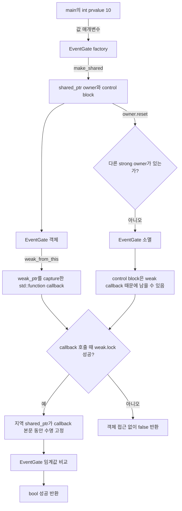

# 2026-10-21 — `weak_from_this` 콜백 수명과 Hungarian 최소 배정

## 오늘의 주제

- 실무 Modern C++: **`std::enable_shared_from_this`와 `weak_from_this()`로 owner보다 오래 살 수 있는 콜백 만들기**
- 대회 알고리즘: **Hungarian 알고리즘, feasible potential, 감소 비용, 증강 경로와 배정 복원**
- 핵심 수명 모델: callback은 `weak_ptr`만 소유하고, 실행 순간 `lock()`이 성공한 동안만 임시 strong owner를 갖는다.

raw `[this]`를 저장한 지연 콜백은 대상이 먼저 파괴되면 댕글링된다. 반대로 `shared_ptr`를 값으로
capture하면 안전하지만 작업 큐가 객체를 필요 이상으로 살려 두거나 순환 소유를 만들 수 있다. 오늘 예제는
공유 소유 객체가 자기 안에서 `weak_from_this()`로 **비소유 취소 가능 callback**을 만든다. callback 실행
시점에만 `weak_ptr::lock()`으로 수명을 고정하고, 마지막 owner가 사라졌다면 접근하지 않고 `false`를 돌려준다.

## 학습 목표

1. `struct`/`class`, 접근 지정자, `explicit`, 멤버 초기화 목록, `using`, template 인자를 초보자 말로 설명한다.
2. lvalue/prvalue/xvalue, 참조 바인딩, `weak_ptr` 복사·이동과 factory 반환의 복사 생략을 실제 식에 표시한다.
3. 객체 수명과 control block 수명, strong/weak ownership, callback wrapper의 소유권을 구분한다.
4. 모든 첫 표준 호출에서 수신자, overload, 인자, 반환, 사후 상태, 복잡도·수명·오류·thread 계약을 말한다.
5. Hungarian의 잠재치, slack, 교대 트리와 증강 불변식으로 최소 완전 배정을 증명한다.
6. CSES 제한에서 `O(n^3)` 시간과 `O(n^2)` 공간, 64-bit 비용 사용 이유를 검증한다.

## 오늘의 ICPC 문제

| 항목 | 내용 |
|---|---|
| 문제 | **CSES 2129 — Task Assignment** |
| 공식 출처 | [https://cses.fi/problemset/task/2129/](https://cses.fi/problemset/task/2129/) |
| 입력 규모 | `1 <= n <= 200`, 각 비용 `1 <= c[i][j] <= 1000` |
| 요구 결과 | 최소 총비용과 직원마다 배정한 서로 다른 작업 번호 |
| 핵심 알고리즘 | 1-based Hungarian: feasible potential 유지 → 최소 slack만큼 갱신 → 0 감소 비용 교대 경로 증강 |
| 시간 복잡도 | `O(n^3)` |
| 추가 공간 | 입력 비용 행렬 포함 `O(n^2)`, Hungarian 보조 배열 `O(n)` |
| 대표 문서 | [`../algorithm/hungarian-assignment.md`](../algorithm/hungarian-assignment.md) |

### 문제를 짧게 다시 말하기

직원과 작업이 각각 `n`개 있고, 직원 `i`가 작업 `j`를 맡을 때 비용 `c[i][j]`가 주어진다. 각 직원은
정확히 하나의 작업을, 각 작업도 정확히 한 직원만 맡도록 완전 배정을 만든다. 가능한 배정 중 총비용이
가장 작은 값을 첫 줄에 출력하고, 이어 직원-작업 쌍 `n`개를 출력한다. 최적해가 여러 개면 하나만 내면 된다.

### 핵심 불변식과 우승 포인트

- `u[i] + v[j] <= c[i][j]`인 feasible potential을 유지하면 모든 감소 비용
  `c[i][j] - u[i] - v[j]`는 음수가 아니다.
- `used` 작업들과 그에 매칭된 직원들이 하나의 교대 트리를 이룬다. 아직 쓰지 않은 작업 `j`의
  `minv[j]`는 이 트리에서 `j`로 나가는 최소 감소 비용이다.
- 가장 작은 slack `delta`만큼 잠재치를 갱신하면 feasible 상태를 깨지 않고 적어도 한 새 간선의
  감소 비용이 0이 된다. 그러므로 내부 반복은 반드시 새 작업으로 전진한다.
- 빈 작업에 도달하면 `way`를 거꾸로 따라 매칭을 뒤집는다. 이전 매칭을 보존하면서 크기가 정확히 1 증가한다.
- 직원 `i`번째 바깥 반복이 끝나면 처음 `i`명의 직원이 서로 다른 작업과 최소비용으로 매칭되어 있다.
- sentinel 열 `0`은 실제 작업이 아니다. 새 직원을 `p[0]`에 임시로 연결하고 같은 갱신 코드로 증강을 시작한다.
- `n=200`, 비용 `<=1000`이면 답은 `200000` 이하이지만, 차감·일반 재사용의 안전 여유를 위해
  비용, 잠재치, slack, 합계를 최소 64-bit 폭을 보장하는 기본 타입 `long long`으로 둔다.
- 같은 문제를 모든 순열 `O(n!)`이나 매번 최단 증강 경로를 만드는 무거운 일반 최소 비용 유량으로 풀기보다,
  조밀한 정사각 비용 행렬이라는 구조를 써서 `O(n^3)`으로 고정한다.

## 생성 파일

- [`README.md`](README.md): 오늘 학습 지도, 구조도, 문제·복잡도·검증 요약
- [`CMakeLists.txt`](CMakeLists.txt): C++23 세 실행 파일, 엄격 경고, 정확 출력 CTest
- [`main.cpp`](main.cpp): owner가 사라지면 안전하게 취소되는 이벤트 코드 임계값 callback
- [`problem.cpp`](problem.cpp): 같은 수명 경계를 다른 지연 작업으로 연습하는 독립 예제
- [`CHECKPOINT.md`](CHECKPOINT.md): 문법·호출 계약·식 해석·Hungarian 증명 문제
- [`icpc_problem.cpp`](icpc_problem.cpp): CSES 2129 제출 가능한 Hungarian 완전 풀이
- [`run_icpc_test.cmake`](run_icpc_test.cmake): 종료 코드와 stdout 전체를 비교하는 CTest helper

## `main.cpp` 구조도



`EventGate`는 실제 임계값을 소유하고 callback은 그 상태를 소유하지 않는다. `lock()`이 성공해 만든 지역
`shared_ptr`만 callback 한 번의 실행 구간 동안 수명을 연장한다. callback 자체를 복사하거나 오래 보관해도
객체 strong count는 증가하지 않는다. 객체가 사라진 뒤에는 control block의 만료 상태만 안전하게 읽는다.

## 초보자를 위한 기초 문법 지도

### `#include`, 기본 타입과 중괄호 초기화

- `<memory>`는 `shared_ptr`, `weak_ptr`, `make_shared`, `enable_shared_from_this`를 선언한다.
- `<functional>`은 서로 다른 callable을 한 서명으로 소유하는 `std::function`을 선언한다.
- `<utility>`는 `std::move`, `<iostream>`은 표준 출력을 선언한다.
- `int minimum_code_{}`는 `int`를 `0`으로 값 초기화한다. 중괄호 초기화는 `double`에서 `int` 같은
  narrowing을 더 엄격히 막는다.
- ICPC 코드의 기본 타입 `long long`은 최소 64-bit 폭을 보장하며 잠재치·slack·비용 합에 사용한다.

### 함수, 반환형, 매개변수와 `const`

- `bool accepts(int event_code)`에서 `bool`은 반환형, 괄호 안은 값 매개변수다. 호출마다 작은 정수를 복사한다.
- `accepts(...) const`의 뒤 `const`는 관찰 함수가 객체의 논리 상태를 바꾸지 않는다는 약속이다.
- `[[nodiscard]]`는 callback이나 관찰 결과를 실수로 버릴 때 컴파일러 진단을 요청한다.
- `noexcept` 함수는 예외를 밖으로 전달하지 않겠다는 계약이다. 그 안에서 예외가 빠져나오면 종료된다.

### 포인터와 참조

- `T&`는 기존 객체를 빌리는 null 불가 lvalue reference이며 소유권이나 수명을 늘리지 않는다.
- raw pointer는 null을 표현하고 재바인딩할 수 있지만, 역시 별도 owner 없이는 대상 수명을 늘리지 않는다.
- `shared_ptr<T>`는 strong ownership을 공유한다. 마지막 strong owner가 사라질 때 `T` 객체가 파괴된다.
- `weak_ptr<T>`는 비소유 관찰자다. `lock()` 성공 결과만 역참조하고 빈 결과는 접근하지 않는다.
- weak owner가 남으면 control block은 남을 수 있지만 이미 파괴된 `T` 객체가 다시 살아나는 것은 아니다.

### `struct`, `class`, 접근 지정자, 생성자와 `using`

- `struct`와 `class`는 모두 데이터와 함수를 가질 수 있다. 기본 접근이 각각 `public`, `private`다.
- 불변식과 수명 정책을 숨기는 `EventGate`는 `class`로 두고 공개 API와 private 상태를 분리한다.
- `explicit EventGate(FactoryKey, int)`는 같은 인자 목록의 의도치 않은 copy-list 변환을 막는다.
- `: std::enable_shared_from_this<EventGate>{}, minimum_code_{minimum_code}`는 본문 전에 base와 멤버를 만든다.
  실제 초기화 순서는 목록 순서가 아니라 base와 멤버 선언 순서다.
- `using Callback = std::function<bool(int)>`는 새 타입이 아니라 긴 template specialization의 별칭이다.
- `std::enable_shared_from_this<EventGate>`의 template 인자 `EventGate`는 어떤 파생 객체의 control block을
  찾아야 하는지 정한다. 기반은 접근 가능한 공개·비모호 상속이어야 한다.
- `EventGate`의 복사·이동 생성자와 대입 연산자를 `= delete`하여 객체 값을 factory 밖으로 복제하지 못하게
  한다. 소유권을 공유하거나 넘길 때는 `EventGate`가 아니라 `shared_ptr<EventGate>` handle을 복사·이동한다.

### 제어문

- `const std::shared_ptr<EventGate> pinned{observer.lock()}`은 먼저 지역 owner를 만들고, 이어 `if (!pinned)`으로
  빈 포인터인지 비교한 뒤 분기한다.
- 성공 경로에서만 `pinned->accepts(event_code)`로 객체를 사용하므로 만료된 대상에 접근하지 않는다.
- Hungarian의 `do/while`은 빈 작업을 찾을 때까지 교대 트리를 늘린다.
- `for`는 후보 작업을 훑어 slack을 갱신한다. `continue`는 이미 tree에 들어온 작업을 건너뛴다.

## Modern C++ 심화: 값 범주·수명·아키텍처

### lvalue, prvalue, xvalue와 참조 바인딩

- 이름 있는 `owner`, `callback`, 생성자 매개변수 `minimum_code`, 지역 `observer`는 저장 위치가 있는 lvalue다.
- `10`, `FactoryKey{}`, `weak_from_this()`와 `lock()`이 반환하는 값은 prvalue다.
- `std::move(observer)`는 lvalue를 같은 weak handle을 가리키는 xvalue로 표시한다. 이 식 자체가
  control block을 옮기지는 않는다.
- 실제 이동은 lambda의 init-capture 멤버가 그 xvalue에 결합해 `weak_ptr` 이동 생성자를 실행할 때 일어난다.
- `const auto pinned = observer.lock()`의 지역 변수는 이름이 있으므로 lvalue지만, 생성 시에는 반환 prvalue가
  직접 결과 객체를 초기화한다.

### 복사·이동, 객체 수명과 복사 생략

- `int` 값 매개변수는 독립 값을 복사하며 외부 객체 수명에 의존하지 않는다. weak observer는 lambda로
  이동되어 callback이 독립 소유하고, 이동 후 원본은 유효하지만 관찰 대상이 보장되지 않는 상태다.
- factory가 `return std::make_shared<EventGate>(...);`로 돌려주는 `shared_ptr` prvalue는 호출자의 결과 객체를
  직접 초기화할 수 있다. 이름 있는 local을 반환할 때의 선택적 NRVO와 구분한다.
- `std::function`은 lambda closure를 값으로 소유한다. lambda가 가진 `weak_ptr` handle은 객체 strong count를
  올리지 않지만 control block 관찰 수명을 유지한다.
- `lock()` 성공 결과는 callback 지역 strong owner다. 함수가 끝날 때 파괴되어 임시 소유권을 반납한다.
- `owner.reset()`이 마지막 strong owner를 버리면 EventGate가 즉시 파괴된다. 이후 callback은 여전히 호출
  가능한 객체이지만 `lock()`이 빈 `shared_ptr`를 반환하므로 EventGate에는 접근하지 않는다.

### 생성 시점과 금지 패턴

- 생성자 안에서는 아직 객체가 shared control block과 연결되지 않았을 수 있다. 너무 이른
  `weak_from_this()`은 빈 weak handle을 만들 수 있으므로 factory가 owner를 만든 뒤 callback을 요청한다.
- private 중첩 `FactoryKey`는 타입 이름뿐 아니라 기본 생성자도 private이고 `EventGate`만 friend다. 따라서
  타입 이름을 생략한 `EventGate{{}, 1}`도 막힌다. 여기에 삭제한 `EventGate` 복사·이동 특수 멤버를 더해
  stack 직접 생성과 기존 객체의 값 복제를 모두 차단하고 factory/shared-control-block 불변식을 유지한다.
- `shared_from_this()`는 owner 연결이 없을 때 예외 경로가 있지만 `weak_from_this()`는 빈 관찰자를 돌려준다.
- `shared_ptr<EventGate>{this}`처럼 raw `this`로 새 owner를 만들면 기존 것과 다른 control block이 생겨 이중
  삭제가 가능하다. 이미 존재하는 control block은 `enable_shared_from_this` 경로로만 찾아야 한다.
- weak/strong 참조 횟수 관리가 thread-safe여도 EventGate의 일반 멤버 동시 접근은 별도 동기화가 필요하다.

### 실무 아키텍처 역할

지연 queue, timer, GUI event, 비동기 완료 처리에서는 등록한 callable이 서비스 객체보다 오래 살 수 있다.
오늘 경계는 “대상이 살아 있으면 실행하고, 아니면 조용히 취소한다”는 정책을 callback 반환 `bool`로 드러낸다.
반드시 실행해야 하는 작업이라면 강한 작업 소유권, 취소 token, 종료 시 drain 같은 별도 정책이 필요하다.
약한 capture는 댕글링과 과도한 생존을 막지만 중복 실행, 순서, 데이터 경쟁, 오류 전달까지 해결하지 않는다.

## 기계 실행 관점

`make_shared`는 보통 객체와 control block을 위한 할당 및 초기화, pointer/refcount store를 수행할 수 있다.
`weak_ptr::lock()`은 control block의 만료 상태를 load하고, 살아 있다면 strong count를 원자적으로 증가시키려
시도한 뒤 성공/실패를 비교·분기할 수 있다. `shared_ptr::reset()`은 count 감소와 마지막 owner 여부 분기를
포함할 수 있다. `std::function` 호출은 타입 소거된 대상에 대한 간접 호출이 될 수 있지만 구현과 최적화에
따라 inline될 수도 있다. Hungarian은 연속 vector 원소의 load/store, 64-bit 뺄셈, 최솟값 비교와 조건
분기를 반복한다. 실제 명령, 할당 결합, 원자 연산 방식, cache 행동과 가상/간접 호출 여부는 CPU, ABI,
표준 라이브러리, 컴파일러와 최적화 옵션에 따라 달라 특정 어셈블리 한 형태로 단정하지 않는다.

## 오늘 사용한 표준 라이브러리

| 핵심 심볼 | 선언 헤더 | 항목 종류 | 실제 호출 멤버/함수 | 현재 코드에서의 역할 | 대표 문서 |
|---|---|---|---|---|---|
| `std::enable_shared_from_this<T>` | `<memory>` | 기반 class template | 기본 생성자, `weak_from_this()` | 객체 내부에서 기존 shared control block을 가리키는 weak handle 생성 | [`ownership-and-vocabulary-types.md`](../standard-library/ownership-and-vocabulary-types.md) |
| `std::shared_ptr<T>` | `<memory>` | 공유 소유 smart pointer | `reset`, `operator bool`, `operator->` | owner 및 callback 실행 중 임시 수명 고정 | [`ownership-and-vocabulary-types.md`](../standard-library/ownership-and-vocabulary-types.md) |
| `std::weak_ptr<T>` | `<memory>` | 비소유 smart handle | 복사·이동 생성자, `lock` | callback이 객체 수명을 연장하지 않고 실행 시점 생존 여부 확인 | [`ownership-and-vocabulary-types.md`](../standard-library/ownership-and-vocabulary-types.md) |
| `std::make_shared<T>` | `<memory>` | 함수 template | `std::make_shared<EventGate>(args...)` | EventGate와 control block을 만들고 최초 shared owner 반환 | [`ownership-and-vocabulary-types.md`](../standard-library/ownership-and-vocabulary-types.md) |
| `std::function<R(Args...)>` | `<functional>` | 타입 소거 callable class template | callable 생성자, `operator()` | weak handle을 소유한 lambda를 안정된 callback 타입으로 저장·호출 | [`ownership-and-vocabulary-types.md`](../standard-library/ownership-and-vocabulary-types.md) |
| `std::move` | `<utility>` | 함수 template | `std::move(observer)` | 이름 있는 weak observer lvalue를 이동 생성을 위한 xvalue로 표시 | [`io-parsing-and-utilities.md`](../standard-library/io-parsing-and-utilities.md) |
| `std::vector` | `<vector>` | 연속 동적 배열 class template | fill 생성자, `operator[]` | 비용 행렬과 Hungarian의 potential/slack/matching/경로 배열 | [`containers-and-views.md`](../standard-library/containers-and-views.md) |
| `std::allocator<T>` | `<memory>` | 기본 할당자 class template | `vector`의 생략된 allocator 인자 | vector 원소 저장소의 할당·해제 정책 | [`containers-and-views.md`](../standard-library/containers-and-views.md) |
| `std::istream`, `std::ostream`, `std::cin`, `std::cout`, `std::ios::sync_with_stdio` | `<iostream>` | stream 타입·객체·정적 함수 | `sync_with_stdio`, `tie`, `operator>>`, `operator<<` | CSES 입력과 배정 결과·학습 결과 출력 | [`io-parsing-and-utilities.md`](../standard-library/io-parsing-and-utilities.md) |

호출 계약 감사에서 확인하는 핵심 표기는 `std::make_shared<`, `weak_from_this(`,
`weak_ptr::lock(`, `shared_ptr::reset(`, `std::function`, `function::operator()`, `std::move(`,
`sync_with_stdio(`, `std::cin.tie(`, `std::cin >>`, `std::cout <<`,
`operator<<(std::ostream&, char)`, weak/shared/function 생성·호출, vector fill 생성자와
`vector::operator[]`이다.

감사 도구의 정확한 대표 명칭으로 쓰면 `std::function 생성자`, `function::operator()`,
`basic_ios::operator!`도 오늘 표와 코드가 다루는 계약이다.

## 직접 해보기

1. callback을 하나 복사해도 EventGate strong count가 늘지 않는 이유를 control block 그림으로 설명한다.
2. weak capture를 strong capture로 바꾸고 `owner.reset()` 뒤 결과와 소멸 시점이 어떻게 달라지는지 예측한다.
3. factory key 제한을 잠시 푼 stack EventGate에서 callback을 만든 경우 안전하게 실패하는지 확인하고 생성자 안에서 만들면 안 되는 이유를 적는다.
4. callback이 다른 thread에서 실행되도록 바꾸고 EventGate 상태에 필요한 mutex/atomic 정책을 설계한다.
5. 반환 `bool`을 `expected`로 바꿔 만료, 잘못된 인자, 정상 실행을 구분한다.
6. 공식 비용 행렬에서 `u`, `v`, `minv`, `p`, `way`의 첫 두 증강을 손으로 추적한다.
7. `n<=8` 무작위 행렬에서 모든 순열 비용을 계산하는 독립 oracle과 결과를 대조한다.
8. 직사각 행렬과 최대 가중치 배정으로 일반화할 때 dummy 행/열과 비용 변환을 설명한다.

## 검증 과정

다음 검증을 수행했고 모두 통과했다.

1. 세 C++ 파일을 w64devkit GCC 16.1.0, C++23, `-Wall -Wextra -Wpedantic -Wconversion
   -Wshadow -Werror`, `_GLIBCXX_ASSERTIONS`로 빌드한다.
2. CMake Release 빌드와 CTest에서 두 학습 예제, 공식 예제, 단일 원소, 대각선, 순환 배정, 큰 비용을 비교한다.
3. 작은 무작위 행렬을 모든 순열 brute-force oracle과 대조하고 출력의 완전 매칭·비용 합을 검사한다.
4. 최대 `n=200` 입력을 실행해 시간/공간이 제한 안에 드는지 확인한다.
5. 알고리즘 문서의 C++ 뼈대를 엄격 옵션으로 컴파일한다.
6. 변경 Markdown의 상대 링크와 모든 텍스트의 UTF-8·마지막 LF·trailing whitespace를 검사한다.
7. 공용 표준 라이브러리 감사 스크립트를 `latest`와 `all` 범위로 실행한다.

재현 명령:

```powershell
$kit = (Resolve-Path tools/w64devkit/bin).Path
$env:Path = "$kit;$env:Path"
cmake -S dailystudy/exercise/2026-10-21 -B build/daily-2026-10-21 -G "MinGW Makefiles" -DCMAKE_BUILD_TYPE=Release "-DCMAKE_CXX_COMPILER=g++.exe"
cmake --build build/daily-2026-10-21 --parallel
ctest --test-dir build/daily-2026-10-21 --output-on-failure
powershell -ExecutionPolicy Bypass -File dailystudy/exercise/tools/audit-standard-library-docs.ps1 -Scope all
```

- CMake Release 빌드 및 CTest: **7/7 통과**
- 독립 무작위 oracle: seed `20261021`, `n=1..8` 각 125개, 총 **1,000/1,000 통과**
- 최대 입력 stress: `n=200`의 9개 패턴을 각 20회, 총 **180/180 통과**;
  전 비용 1000 패턴의 프로세스 시작·I/O 포함 중앙값 약 **20.995ms**, 최댓값 약 **31.858ms**
- Markdown C++ 예제: 엄격 컴파일 후 공식/무작위/최대 입력 **243/243 통과**
- 문서 링크 및 텍스트 품질: 변경 Markdown 9개에서 로컬 링크 **464개** 유효,
  의도한 15개 파일의 UTF-8·마지막 LF·trailing whitespace 검사 통과
- 공용 문서 감사(`all`): **75일 / C++ 206개 / 심볼 195개 / 헤더 58개 /
  멤버 60개 / 연산 5개**, 누락 0개
