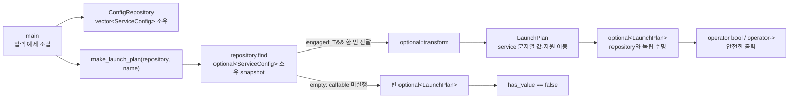

# 2026-10-22 — `optional::transform` 소유 투영과 대입·덧셈 Lazy Segment Tree

오늘은 C++23 `std::optional::transform`으로 **있을 수도 있는 저장소 snapshot을 외부 계층이 소유하는 DTO로 투영하는 경계**를 만든다. 대회 문제는 [CSES 1735 — Range Updates and Sums](https://cses.fi/problemset/task/1735/)이며, 구간 대입과 구간 덧셈의 순서를 보존하는 지연 전파 세그먼트 트리로 푼다.

## 오늘의 목표

- `optional<T>`가 `T`를 자기 저장소에 직접 소유하며 null pointer와 다른 상태 모델임을 설명한다.
- `optional::transform(`이 engaged일 때만 callable을 한 번 실행하고 empty를 그대로 전파함을 코드 식과 연결한다.
- `&`, `const &`, `&&`, `const &&` 수신 객체에 따라 callable이 각각 `T&`, `const T&`, `T&&`, `const T&&`를 받는 이유를 이해한다.
- rvalue optional을 transform해도 원본이 자동으로 empty가 되는 것은 아니며, contained 값만 moved-from 상태가 될 수 있음을 구분한다.
- 세그먼트 트리 노드 합은 항상 최신이고 자식만 지연될 수 있다는 불변식을 증명한다.
- `add → assign`과 `assign → add`가 다른 비가환 tag 합성을 직접 추적한다.

## 생성 파일

- [`main.cpp`](main.cpp): 저장소의 선택적 `ServiceConfig` snapshot을 소유 `LaunchPlan`으로 투영하는 실무 패턴
- [`problem.cpp`](problem.cpp): `optional<int>`의 성공값만 두 배로 바꾸는 초보자 실습
- [`icpc_problem.cpp`](icpc_problem.cpp): CSES 1735 제출 가능한 완전한 풀이
- [`CMakeLists.txt`](CMakeLists.txt): C++23 엄격 경고 빌드와 여섯 개 정확 출력 테스트
- [`run_icpc_test.cmake`](run_icpc_test.cmake): stdin/stdout 비교 helper
- [`CHECKPOINT.md`](CHECKPOINT.md): 문법·값 범주·호출 계약·lazy tag 합성 검증 문제

공용 대표 문서는 새 중복 파일을 만들지 않고 다음 두 파일을 멱등적으로 보강한다.

- [`../algorithm/lazy-segment-tree.md`](../algorithm/lazy-segment-tree.md): 지연 전파 불변식, 대입/덧셈 합성, 정확성, 복잡도
- [`../standard-library/ownership-and-vocabulary-types.md`](../standard-library/ownership-and-vocabulary-types.md): `std::optional::transform`의 ref-qualified 호출·소유권·오류 계약

## `main.cpp` 구조도



`ConfigRepository`가 내부 `vector`를 소유하고 `find`는 원소 reference를 밖으로 노출하지 않고 `ServiceConfig`를 복사한 snapshot을 반환한다. `make_launch_plan`은 이름 있는 `found`를 `std::move(found)`로 xvalue로 바꾼 뒤 `transform`의 `&&` overload를 선택한다. 성공 경로에서는 `config.service`의 문자열 값과 재사용 가능한 자원을 결과 DTO 구성에 사용하고, 실패 경로에서는 lambda 자체를 호출하지 않는다. 결과 `LaunchPlan`이 모든 데이터를 소유하므로 repository보다 오래 살아도 dangling reference가 없다. 다만 표준은 이동 뒤 값과 유효한 moved-from 상태를 보장할 뿐, SSO를 포함한 모든 구현에서 heap buffer를 그대로 넘긴다고 보장하지 않는다.

## 기초 문법부터 읽기

- `struct ServiceConfig { ... };`에서 `struct`의 기본 접근은 `public`이다. 단순 데이터 묶음에 어울린다.
- `class ConfigRepository { public: ... private: ... };`에서 `class`의 기본 접근은 `private`이다. 저장소 불변식을 숨긴다.
- `int replicas{};`의 `{}`는 기본 타입을 0으로 값 초기화하며 narrowing을 엄격히 검사한다.
- `using Value = long long;`은 새 타입을 만드는 것이 아니라 긴 타입에 읽기 쉬운 별칭을 붙인다.
- `explicit ConfigRepository(...)`는 vector 한 개가 repository로 암시 변환되는 것을 막는다.
- 생성자의 `: configs_{std::move(configs)}`는 본문 전에 실행되는 멤버 초기화 목록이다. 실제 초기화 순서는 목록 순서가 아니라 멤버 선언 순서다.
- `const ConfigRepository&`는 null이 될 수 없는 읽기 전용 별칭이며 소유권을 늘리지 않는다. pointer는 null일 수 있지만 reference는 이미 유효한 객체에 바인딩되어야 한다.
- 멤버 함수 뒤의 `const`는 관찰 가능한 repository 상태를 바꾸지 않겠다는 계약이다.
- `[[nodiscard]]`는 중요한 반환값을 실수로 버릴 때 진단을 유도한다.
- `if`, `for`, `{}` block은 조건 분기와 반복 범위를 만든다. 반복 중 vector 크기를 바꾸지 않아 반복자·reference가 유효하다.

## 값 범주·복사·이동·수명

`found`처럼 이름 있는 변수 식은 lvalue다. `std::move(found)`는 데이터를 직접 옮기지 않고 같은 객체를 가리키는 xvalue를 만든다. 이어 선택된 `transform(F&&) &&`가 contained `ServiceConfig`를 `ServiceConfig&&`로 lambda에 전달하고, lambda 안 `std::move(config.service)` 뒤의 `std::string` 이동 생성이 문자열 값과 재사용 가능한 자원을 `LaunchPlan`으로 옮긴다. 이동 생성 뒤 source는 유효하지만 값은 미지정이며, 작은 문자열 최적화에서는 문자가 복사될 수도 있다.

`repository.find(service)`와 `make_launch_plan(...)` 호출 결과는 prvalue다. 같은 타입의 목적 객체를 직접 초기화할 때 C++17의 보장 복사 생략으로 중간 optional 복사/이동이 필요 없다. 반면 이름 있는 local을 `return local;`로 돌려주는 NRVO는 허용되지만 일반적으로 선택적 최적화다.

`std::string_view service`는 문자를 소유하지 않는다. 호출 동안 backing characters가 살아 있어야 한다. 오늘 호출은 프로그램 전체 수명을 가진 문자열 literal을 보므로 안전하다. 반환 결과는 `std::string`을 소유하므로 view나 repository의 수명을 빌리지 않는다.

## `transform`과 `and_then` 구분

- `transform(F)`: `F`가 평범한 `U`를 반환하고 결과는 `optional<U>`가 된다. `F`가 우연히 `optional<U>`를 반환하면 `optional<optional<U>>`처럼 중첩된다.
- `and_then(F)`: `F`가 이미 `optional<U>`를 반환해야 하고 결과를 한 단계로 평탄하게 연결한다.
- 둘 다 empty receiver에서는 callable을 실행하지 않는다. “부재”와 “검증 실패 이유”를 구분해야 한다면 오류 대안을 가진 `expected<T,E>`가 더 알맞을 수 있다.

## 오늘의 ICPC 문제

| 항목 | 내용 |
|---|---|
| ID | CSES 1735 |
| 제목 | Range Updates and Sums |
| 출처 | [CSES Problem Set 공식 문제](https://cses.fi/problemset/task/1735/) |
| 입력 규모 | `1 <= n,q <= 200000`, `1 <= t_i,x <= 1000000` |
| 명령 | 닫힌 1-based 구간에 덧셈, 대입, 또는 구간 합 질의 |
| 핵심 알고리즘 | 대입·덧셈 tag를 합성하는 Lazy Segment Tree |
| 시간 복잡도 | 빌드 `O(n)`, 각 명령 `O(log n)`, 전체 `O(n + q log n)` |
| 공간 복잡도 | tree/tag 배열 `O(n)`, 재귀 stack `O(log n)` |

### 문제 요약과 고급 불변식

각 노드는 담당 구간의 **현재 논리 합**을 항상 저장한다. tag는 자식 합에 아직 전달하지 않은 시간순 연산만 나타낸다. 따라서 완전 포함 질의는 자식이 오래된 상태여도 부모 합을 즉시 사용할 수 있고, 일부 구간으로 내려갈 때만 `push`한다.

오늘 구현은 tag를 다음 함수 형태로 유지한다.

- `has_assignment == false`: `f(v) = v + addition`이다.
- `has_assignment == true`: `f(v) = assignment + addition`이다. 이때 과거 입력 `v`는 버린다.

새 대입은 과거 대입과 덧셈을 모두 덮고 `addition=0`으로 만든다. 새 덧셈은 현재 tag의 `addition`에 누적한다. 자식에 내릴 때 대입을 먼저, 덧셈을 나중에 적용하면 시간 순서가 보존된다. 예를 들어 `+5` 뒤 `=2`는 최종 2지만, `=2` 뒤 `+5`는 최종 7이다. 이 순서를 뒤집는 것이 가장 흔한 오답 원인이다.

합은 `n=200000`, 큰 갱신이 반복될 때 32-bit `int`를 훨씬 넘을 수 있으므로 `long long`을 쓴다. 문제 제약 아래 최악 누적 합은 대략 `4 * 10^16` 규모로 signed 64-bit 안에 들어온다.

## 오늘 사용한 표준 라이브러리

| 핵심 심볼 | 선언 헤더 | 항목 종류 | 실제 호출 멤버/함수 | 현재 코드에서의 역할 | 대표 문서 |
|---|---|---|---|---|---|
| `std::optional<T>`, `std::nullopt` | `<optional>` | class template, tag 객체 | 값/nullopt 생성자, `optional::transform(`, `operator bool`, `operator->`, `has_value`, `value_or` | 선택적 snapshot, 성공값 투영, 안전한 부재 전파 | [소유권·어휘 타입](../standard-library/ownership-and-vocabulary-types.md) |
| `std::vector<T>` | `<vector>` | 연속 소유 container | initializer-list 생성자, fill 생성자, 이동 생성자, `vector::size`, `vector::operator[]`, `begin`, `end` | 설정 목록과 segment tree/tag 배열 소유 | [컨테이너·뷰](../standard-library/containers-and-views.md) |
| `std::string` | `<string>` | 소유 문자열 타입 | 리터럴/복사 경로, 복사/이동 생성자, `string_view` 변환 연산자 | 서비스 이름의 독립 수명 소유 | [입출력·파싱](../standard-library/io-parsing-and-utilities.md) |
| `std::string_view` | `<string_view>` | 비소유 문자 view | C 문자열 생성자, 동등 비교 `operator==` | 조회 기간에만 서비스 이름을 빌림 | [컨테이너·뷰](../standard-library/containers-and-views.md) |
| `std::move` | `<utility>` | 함수 template | `std::move(found)`, `std::move(config.service)` | rvalue overload 선택과 소유권 이전 의도 표현 | [입출력·파싱](../standard-library/io-parsing-and-utilities.md) |
| `std::cin`, `std::cout`, `std::ios::sync_with_stdio` | `<iostream>` | 표준 stream 객체·함수 | `sync_with_stdio(`, `std::cin.tie(`, `std::cin >>`, `std::cout <<`, `operator<<(std::ostream&, char)` | 대회 입력과 정답 출력 | [입출력·파싱](../standard-library/io-parsing-and-utilities.md) |

각 첫 호출 바로 위의 여섯 항목 계약 주석은 수신 타입/상태, overload와 template 인자, 인자의 타입·값 범주·소유 의미, 반환값 사용, 호출 뒤 상태, 복잡도·할당·무효화·수명·오류·thread 전제를 함께 적는다.

## 기계 실행 관점

개념적으로 repository 검색에는 문자열 길이/문자 load와 비교, 반복 조건 분기가 있고 optional에는 존재 상태 load/store가 있다. lazy tree에는 node 합/tag load, tag 합성 store, 포함 관계 비교와 조건 분기, 재귀 호출이 있다. 이 예제에는 virtual 함수가 없어 가상 간접 호출은 없다. lambda와 작은 함수는 inline될 수 있지만 실제 load/store/분기/호출/할당의 수와 배치는 CPU, ABI, 표준 라이브러리 구현, 컴파일러와 Debug/Release 최적화 옵션에 따라 달라진다.

## 빌드와 검증

저장소 루트의 w64devkit GCC를 사용한다. build 산출물은 Git에 포함하지 않는다.

```powershell
$kit = (Resolve-Path tools/w64devkit/bin).Path
$env:Path = "$kit;$env:Path"
cmake -S dailystudy/exercise/2026-10-22 -B build/daily-2026-10-22 -G Ninja `
  "-DCMAKE_CXX_COMPILER=g++.exe" -DCMAKE_BUILD_TYPE=Release
cmake --build build/daily-2026-10-22
ctest --test-dir build/daily-2026-10-22 --output-on-failure
powershell -ExecutionPolicy Bypass -File dailystudy/exercise/tools/audit-standard-library-docs.ps1 -Scope all
```

검증 과정은 다음을 고정한다.

1. `main.cpp`는 성공 DTO `billing 3`과 빈 결과 `0`을 출력한다.
2. `problem.cpp`는 값이 있는 경우만 lambda를 실행해 `42 -1`을 출력한다.
3. CSES 공식 예제는 `7`, `11`, `15`를 출력한다.
4. 길이 1, `add -> assign -> add`, 부모 tag의 부분 push를 각각 독립 CTest로 검증한다.
5. 작은 무작위 배열을 단순 `O(nq)` oracle과 비교하고 최대 제약 stress로 시간·64-bit 범위를 확인한다.
6. 공용 표준 라이브러리 감사로 모든 헤더·심볼·추적 멤버와 첫 호출 계약 표식을 확인한다.

최종 실행에서는 w64devkit GCC 16.1.0 Release 엄격 경고 빌드와 CTest `6/6`이 통과했다. 고정 seed 무작위 oracle `600/600` 사례가 단순 배열 결과와 일치했고, `n=q=200000`에서 199,999번의 최대 덧셈 뒤 전체 합 `39999800000200000`도 일치했다. 두 공용 문서의 C++23 예제를 별도로 컴파일했고, 로컬 Markdown 링크 469개를 확인했다. `latest`와 `all` 표준 라이브러리 감사는 각각 통과했으며 전체 집계는 날짜 76개, C++ 파일 209개, 심볼 196개, 헤더 58개, 추적 멤버 61개, 연산 계열 5개다.

더 자세한 자기 검증은 [`CHECKPOINT.md`](CHECKPOINT.md)를 사용한다.
