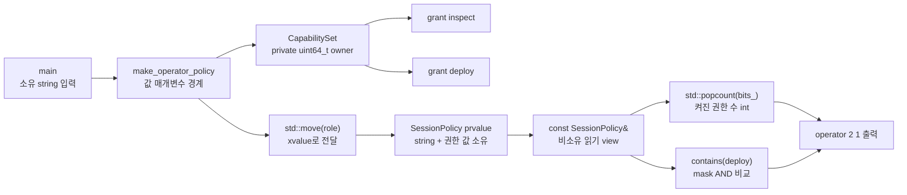

# 2026-10-23 — `std::popcount` 권한 값 타입과 DAG word-bitset 전이 폐쇄

오늘은 C++20 `std::popcount`를 raw 정수 조작이 아니라 **권한 비트를 캡슐화한 값 타입의 관찰 연산**으로 사용한다. 대회 문제는 [CSES 2138 — Reachable Nodes](https://cses.fi/problemset/task/2138/)이며, DAG를 역위상 순서로 훑으면서 정점별 도달 집합을 64비트 word 배열로 합치는 전이 폐쇄로 푼다.

## 오늘의 목표

- `enum class`와 private 64비트 저장소로 외부 정수와 권한 의미를 분리한다.
- `std::popcount`의 unsigned 정수 제약, `int` 반환, `constexpr`/`noexcept`, 상태 불변 계약을 설명한다.
- 값 타입의 독립 소유, `std::move`가 만드는 xvalue, 실제 문자열 이동 생성, prvalue 직접 초기화와 NRVO를 구분한다.
- DAG에서 `R(u) = {u} union 모든 R(v), u->v` 점화식이 역위상 순서에서만 한 번에 완성됨을 증명한다.
- `n=50,000`에서 `W=782`인 bit matrix의 약 298.3MiB 메모리와 약 `(n+m)W` word 연산을 대회 전에 계산한다.
- 모든 표준 라이브러리 첫 호출을 수신자, overload, 인자, 반환, 사후 상태, 오류·복잡도·수명·thread의 여섯 항목으로 읽는다.

## 생성 파일

- [`main.cpp`](main.cpp): `CapabilitySet` 값 타입과 소유 `SessionPolicy`를 조립하는 실무 패턴
- [`problem.cpp`](problem.cpp): 64비트 권한 마스크와 `std::popcount`를 직접 수정하는 초보자 실습
- [`icpc_problem.cpp`](icpc_problem.cpp): CSES 2138 제출 가능한 완전한 풀이
- [`CMakeLists.txt`](CMakeLists.txt): C++23 엄격 경고 빌드와 일곱 개 정확 출력 테스트
- [`run_icpc_test.cmake`](run_icpc_test.cmake): stdin/stdout·종료 코드를 비교하는 CTest helper
- [`CHECKPOINT.md`](CHECKPOINT.md): 문법·값 범주·호출 계약·bitset DP를 스스로 증명하는 검증 문제

공용 지식은 중복 파일을 만들지 않고 다음 대표 문서에서 관리한다.

- [`../algorithm/dag-transitive-closure-word-bitsets.md`](../algorithm/dag-transitive-closure-word-bitsets.md): 정의, 불변식, 정확성 증명, 복잡도, 메모리, 변형
- [`../standard-library/bit-and-byte-utilities.md`](../standard-library/bit-and-byte-utilities.md): `std::popcount`의 재사용 가능한 호출 계약
- [`../standard-library/containers-and-views.md`](../standard-library/containers-and-views.md): `std::vector` 생성·성장·인덱싱·무효화
- [`../standard-library/io-parsing-and-utilities.md`](../standard-library/io-parsing-and-utilities.md): stream 연산과 `std::move`

## `main.cpp` 구조도



`CapabilitySet`은 단 하나의 `std::uint64_t`를 직접 소유하고 raw 저장소를 private로 숨긴다. `SessionPolicy`는 역할 `std::string`과 권한 값의 소유 DTO다. 출력 함수는 `const SessionPolicy&`로 잠깐 빌릴 뿐 소유권이나 수명을 늘리지 않는다. 따라서 factory의 지역 매개변수가 사라진 뒤에도 결과가 dangling view를 갖지 않는다.

## 기초 문법부터 읽기

- `enum class Capability : unsigned`는 열거자를 강한 타입으로 만들고 기저 정수와의 암시 변환을 막는다. `inspect=0`은 0번째 비트 위치다.
- `using BitWord = std::uint64_t;`는 새 타입이 아니라 읽기 쉬운 별칭이다. `std::uint64_t`가 있는 구현에서는 정확히 64비트다.
- `BitWord bits_{};`의 `{}`는 기본 정수를 0으로 값 초기화하고 narrowing 변환을 거부한다.
- `class CapabilitySet`의 기본 접근은 `private`, `struct SessionPolicy`의 기본 접근은 `public`이다. 전자는 불변식을 숨기고 후자는 단순 DTO를 드러낸다.
- `public:`과 `private:`는 runtime 보안 장치가 아니라 컴파일 시간 접근 규칙이다.
- `explicit CapabilitySet(BitWord)`는 정수 하나가 권한 집합으로 암시 변환되는 일을 막는다.
- 생성자의 `: bits_{initial_bits & kKnownBits}`는 본문 전에 raw 값의 미지 bit를 제거하며 실행되는 멤버 초기화 목록이다. 실제 초기화 순서는 목록이 아니라 멤버 선언 순서다.
- `count() const`의 뒤 `const`는 이 호출이 관찰 가능한 객체 상태를 바꾸지 않는다는 뜻이다.
- `const SessionPolicy&`는 null이 될 수 없는 읽기 전용 별칭이며 소유권을 늘리지 않는다. pointer는 null과 재바인딩을 표현할 수 있지만 가리킨 객체를 자동 소유하지는 않는다.
- `if`는 bool 조건을 비교해 한쪽 block으로 분기하고, `for`는 초기화·조건 비교·증가와 중괄호 block을 반복한다.
- `std::vector<Word>`에서 `Word`는 원소 타입 template 인자다. 오늘 ICPC 구현은 `vector<vector<Node>>`로 인접 목록을, flat `vector<Word>`로 행렬을 소유한다.

## 값 범주·복사·이동·수명

`role`, `policy`, `capabilities`처럼 이름 있는 변수 식은 lvalue다. `std::string{"operator"}`와 `SessionPolicy{...}`는 prvalue이고 목적 객체를 직접 초기화한다. `std::move(role)`은 문자열을 스스로 옮기는 함수가 아니라 같은 객체를 가리키는 xvalue reference를 만든다. 이어 선택된 `std::string` 이동 생성자가 값과 재사용 가능한 자원을 결과 DTO로 이전한다. 원본은 살아 있지만 값은 미지정이며 작은 문자열 최적화 때문에 문자가 실제로 복사될 수도 있다.

`return SessionPolicy{std::move(role), capabilities};`의 같은 타입 prvalue는 C++17 보장 복사 생략으로 호출자의 목적 객체를 직접 초기화할 수 있다. 반면 `make_example_mask()`의 이름 있는 `return mask;`에는 NRVO가 허용되지만 일반 규칙상 의무는 아니다. `CapabilitySet`은 64비트 값 하나만 소유하므로 암시적 복사와 이동 모두 독립 값 복사처럼 동작한다.

`print_policy(const SessionPolicy& policy)`의 reference는 호출 동안만 원본을 빌린다. 함수가 그 reference를 장기 저장하지 않고 호출자 `policy`가 더 오래 사므로 안전하다. ICPC의 graph와 bit matrix도 vector가 원소 수명을 소유하고, 함수의 const reference는 호출 동안만 관찰한다.

## 실무 패턴: raw mask를 경계 안에 가두기

권한 비트 표현을 모든 호출부가 직접 다루면 shift 범위, enum 매핑, unsigned 타입을 반복해서 맞춰야 한다. 오늘 `CapabilitySet`은 raw 정수 생성자를 `explicit`으로 만들고 알려진 bit만 보존하며, 상태 조작은 `grant`, `contains`, `count`로 모아 다음 불변식을 한곳에 둔다.

1. 알려진 열거자는 안전한 고정 shift로 바뀌며, 강제 변환된 미지의 값은 0 mask가 되어 UB를 만들지 않는다.
2. `bits_`만 실제 저장소 owner이고 반환 reference나 pointer를 외부에 노출하지 않는다.
3. `grant`는 OR의 멱등성 때문에 같은 권한을 여러 번 추가해도 값이 같다.
4. `count`는 상태를 바꾸지 않고 독립 `int` 값만 반환한다.

권한 수가 실행 시간에 64를 넘는 제품이라면 ICPC 풀이처럼 `vector<uint64_t>`를 소유하는 동적 값 타입으로 확장할 수 있다. 그때는 universe 크기, 마지막 word의 padding bit, 복사/이동 뒤 class 불변식, vector 재할당에 따른 view 무효화를 새 계약으로 추가해야 한다.

## 오늘의 ICPC 문제

| 항목 | 내용 |
|---|---|
| ID | CSES 2138 |
| 제목 | Reachable Nodes |
| 출처 | [CSES Problem Set 공식 문제](https://cses.fi/problemset/task/2138/) |
| 입력 규모 | `1 <= n <= 50,000`, `1 <= m <= 100,000`, 입력은 DAG |
| 요구값 | 각 정점에서 자기 자신을 포함해 도달 가능한 서로 다른 정점 수 |
| 핵심 알고리즘 | Kahn 위상 정렬 + 역위상 DP + flat 64-bit word bitset 전이 폐쇄 |
| 시간 복잡도 | `O(n+m+(n+m)ceil(n/64))`, 간단히 `O((n+m)ceil(n/64))` word 연산 |
| 공간 복잡도 | `O(n ceil(n/64)+n+m)` |

### 점화식과 정확성 불변식

정점 `u`의 정확한 도달 집합을 `R(u)`라 하면 다음이 성립한다.

```text
R(u) = {u} union (union over every edge u -> v of R(v))
```

위상 순서에서는 모든 간선 `u -> v`에 대해 `u`가 먼저다. 따라서 순서를 뒤집으면 `u`를 처리할 때 모든 `R(v)`가 이미 완성돼 있다. 자신의 비트를 켜고 각 후속 행을 OR하면 다음 두 방향이 모두 성립한다.

- soundness: 새로 켜지는 비트는 자기 자신이거나 실제 간선 `u->v` 뒤 실제 경로가 있는 정점뿐이다.
- completeness: `u`에서 가는 길이 1 이상 경로는 반드시 첫 간선 `u->v`를 가지며 나머지 목적지는 완성된 `R(v)`에 있다.

같은 정점으로 가는 경로나 병렬 간선이 여럿이어도 OR은 멱등적이라 한 비트만 남는다. 이 때문에 경로 수가 아니라 **서로 다른 정점 수**를 정확히 센다.

### 시간·공간을 숫자로 먼저 계산하기

`n=50,000`이면 `W=ceil(n/64)=782`다. flat 행렬만 다음 크기다.

```text
50,000 * 782 * 8 = 312,800,000 bytes ~= 298.3 MiB
```

여기에 adjacency, indegree, 위상 순서, vector 객체와 allocator 오버헤드가 더해진다. 각 간선은 `W`개 word를 OR하고 마지막에 `nW`개 word를 popcount하므로 최악에는 약 1억 단위의 단순 word 작업과 수백 MiB memory traffic이 생긴다. Big-O만 맞아도 row를 흩어진 작은 allocation으로 만들거나 반복마다 임시 집합을 복사하면 1초 제한에서 불리하다. 오늘 구현은 한 flat vector를 행 우선으로 순회한다.

## 오늘 사용한 표준 라이브러리

| 핵심 심볼 | 선언 헤더 | 항목 종류 | 실제 호출 멤버/함수 | 현재 코드에서의 역할 | 대표 문서 |
|---|---|---|---|---|---|
| `std::popcount` | `<bit>` | C++20 함수 template | `std::popcount(bits_)`, `std::popcount(reachability[row+word])` | 권한 비트와 완성된 도달 행의 1비트 개수 계산 | [비트·바이트](../standard-library/bit-and-byte-utilities.md) |
| `std::uint64_t`, `std::size_t` | `<cstdint>`, `<cstddef>` | 고정 폭·크기 타입 별칭 | 64비트 word 값/shift, 행·word 인덱스와 크기 계산 | unsigned 비트 연산과 overflow 없는 저장소 크기 표현 | [비트·바이트](../standard-library/bit-and-byte-utilities.md) |
| `std::string` | `<string>` | 소유 문자열 class | `const char*` 생성자, 이동 생성자 | 역할 이름을 factory 인자와 독립적으로 소유 | [컨테이너·뷰](../standard-library/containers-and-views.md) |
| `std::move` | `<utility>` | 값 범주 변환 함수 template | `std::move(role)` | string 이동 생성자 선택을 허용하는 xvalue 생성 | [입출력·유틸리티](../standard-library/io-parsing-and-utilities.md) |
| `std::vector<T>` | `<vector>` | 연속 소유 container template | 기본 생성자, count 생성자, fill 생성자, `vector::size`, `vector::operator[]`, `vector::reserve`, `vector::push_back` | adjacency, indegree, FIFO, 위상 순서, flat bit matrix 소유 | [컨테이너·뷰](../standard-library/containers-and-views.md) |
| `std::ios`, `std::cin`, `std::istream` | `<iostream>` | stream 기본 타입·표준 입력 객체·타입 | `std::ios::sync_with_stdio(`, `std::cin.tie(`, `std::cin >>` 정수 추출 | C/C++ stream 동기화 설정, tie 해제, 빠른 대회 입력 | [입출력·유틸리티](../standard-library/io-parsing-and-utilities.md) |
| `std::cout`, `std::ostream` | `<iostream>` | 표준 출력 객체·타입 | `std::cout <<`, 산술/string 삽입, `operator<<(std::ostream&, char)` | 예제 결과와 n개 정답 출력 | [입출력·유틸리티](../standard-library/io-parsing-and-utilities.md) |

각 코드 파일의 첫 실제 호출 바로 위에는 정확한 수신 상태, 선택 overload/template, 모든 인자와 값 범주·소유 의미, 반환값 사용 여부, 사후 상태, 복잡도·할당·무효화·수명·오류·thread 전제를 함께 적었다.

## 기계 실행 관점

`CapabilitySet::contains`는 개념적으로 word load, mask 생성, AND, 0 비교를 수행할 수 있다. bitset 합집합의 안쪽 문장에는 source/destination word load, OR, destination store가 있고, Kahn의 `if (--indegree[next] == 0)`에는 load·감소 store·비교·조건 분기가 있다. `std::popcount`는 CPU가 지원하면 population-count 명령으로, 그렇지 않으면 여러 비트 연산이나 library sequence로 구현될 수 있다.

오늘 타입에는 virtual 함수가 없어 가상 간접 호출을 요구하지 않는다. 다만 실제 load/store 수, SIMD vectorization, branch 제거, inline, hardware popcount 사용과 cache miss는 CPU, ABI, 표준 라이브러리, 컴파일러, Debug/Release와 target 옵션에 따라 달라진다. 소스 한 줄과 특정 assembly 한 줄을 일대일로 단정하지 않고 최대 입력에서 측정한다.

## 빌드와 검증

저장소 루트의 w64devkit GCC를 사용하며 build 산출물은 Git에 포함하지 않는다.

```powershell
$kit = (Resolve-Path tools/w64devkit/bin).Path
$env:Path = "$kit;$env:Path"
cmake -S dailystudy/exercise/2026-10-23 -B build/daily-2026-10-23 -G Ninja `
  "-DCMAKE_CXX_COMPILER=g++.exe" -DCMAKE_BUILD_TYPE=Release
cmake --build build/daily-2026-10-23
ctest --test-dir build/daily-2026-10-23 --output-on-failure
powershell -ExecutionPolicy Bypass -File dailystudy/exercise/tools/audit-standard-library-docs.ps1 -Scope all
```

검증 과정은 다음을 고정한다.

1. `main.cpp`는 `operator 2 1`, `problem.cpp`는 `3 1`을 출력한다.
2. CSES 공식 예제는 `5 3 2 2 1`을 출력한다.
3. chain, 합류 diamond, 분리 component, 중복 간선에서 자기 포함·중복 제거·정보 방향을 각각 검증한다.
4. 작은 무작위 DAG를 정점별 DFS oracle과 비교한다.
5. 최대 `n=50,000`, 약 `m=100,000`인 DAG에서 메모리·시간과 첫/마지막 답을 확인한다.
6. 공용 알고리즘 문서의 C++23 뼈대를 별도로 컴파일하고 모든 상대 Markdown 링크를 검사한다.
7. `latest`와 `all` 표준 라이브러리 감사로 심볼·헤더·호출 계약 색인을 확인한다.

최종 실행에서 w64devkit GCC 16.1.0 엄격 경고 Release 빌드와 CTest `7/7`이 통과했다. 고정 seed 무작위 DAG `1,000/1,000`개가 정점별 DFS oracle과 일치했다. 최대 `n=50,000`, `m=100,000`의 chain+skip DAG도 첫 답 `50,000`, 마지막 답 `1`로 통과했으며 로컬 측정은 약 `0.189`초였다. 공용 문서 C++23 코드 블록 3개를 별도로 컴파일했고 변경 문서의 상대 링크 471개, 의도 파일 15개의 UTF-8/final-LF/후행 공백 상태를 확인했다. `latest`와 `all` 감사가 모두 통과했으며 전체 집계는 날짜 77개, C++ 파일 212개, 심볼 197개, 헤더 58개, 추적 멤버 61개, 생성자·연산자 계열 5개다. 시간 수치는 이 PC의 한 실행값이며 온라인 저지 성능 보장은 아니다.

더 자세한 자기 검증은 [`CHECKPOINT.md`](CHECKPOINT.md)를 사용한다.
