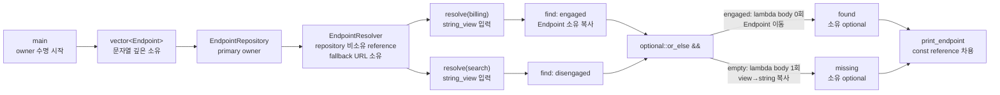

# 2026-10-26 — `std::optional::or_else` 소유 fallback과 암시적 트립

오늘은 C++23 `std::optional::or_else`로 **값이 없을 때만 실행되는 fallback factory**를 표현한다. 실무 예제는 1차 Endpoint 저장소가 값을 찾으면 그 소유 복사본을 유지하고, 찾지 못하면 입력 `string_view`와 resolver 내부 URL을 새 `std::string`으로 복사해 독립 수명의 Endpoint를 반환한다.

대회 문제는 [CSES 2074 — Reversals and Sums](https://cses.fi/problemset/task/2074/)다. 배열의 현재 위치를 암시 key로 쓰는 treap, 입력과 독립인 실행별 priority seed, subtree 합, lazy reverse tag를 결합해 각 구간 뒤집기/합 질의를 기대 `O(log n)`에 처리한다.

## 오늘의 목표

1. `optional<T>`의 engaged/disengaged 상태와 `or_else`의 성공/부재 분기를 구분한다.
2. `or_else(F&&) const &`와 `or_else(F&&) &&`의 복사·이동 차이, callable 반환 제약, 예외·수명 계약을 실제 식으로 설명한다.
3. `string_view` 입력을 API 안에 저장하지 않고 소유 `string`으로 materialize하는 수명 경계를 설계한다.
4. lvalue/prvalue/xvalue, reference binding, 실제 복사/이동, 객체 수명, 소유권, 보장 복사 생략과 NRVO를 구별한다.
5. 암시적 트립의 sequence/heap/size/sum/lazy 불변식을 유지하는 `split`, `merge`, `push`, `pull`을 증명한다.
6. 기대 복잡도와 병적인 최악 복잡도, recursion stack 위험을 분리해 말한다.
7. 모든 표준 라이브러리 첫 호출을 수신자·overload·인자·반환·사후 상태·오류/복잡도/수명/thread의 여섯 항목으로 읽는다.

## 생성 파일

- [`main.cpp`](main.cpp): 저장소 성공값 또는 소유 fallback Endpoint를 반환하는 실무 resolver
- [`problem.cpp`](problem.cpp): `admin`/`guest` 두 경로를 확인하는 초보자용 `or_else` 실습
- [`icpc_problem.cpp`](icpc_problem.cpp): CSES 2074에 제출 가능한 index-arena 암시적 트립 풀이
- [`CMakeLists.txt`](CMakeLists.txt): C++23 엄격 경고 빌드와 정확 출력 CTest 7개
- [`run_icpc_test.cmake`](run_icpc_test.cmake): stdin/stdout/종료 코드를 비교하는 CTest helper
- [`CHECKPOINT.md`](CHECKPOINT.md): 문법·수명·호출 계약·treap 정확성을 스스로 설명하는 검증 문제

공용 지식은 중복 파일을 만들지 않고 다음 대표 문서에 유지한다.

- [`../algorithm/implicit-treap-range-reversal-sum.md`](../algorithm/implicit-treap-range-reversal-sum.md): 적용 조건, 불변식, 절차, 코드 뼈대, 증명, 복잡도, 실전 함정
- [`../standard-library/ownership-and-vocabulary-types.md`](../standard-library/ownership-and-vocabulary-types.md): `optional` 상태·접근과 C++23 `or_else` 계약
- [`../standard-library/containers-and-views.md`](../standard-library/containers-and-views.md): `vector`, `string`, `string_view`의 소유·무효화 계약
- [`../standard-library/io-parsing-and-utilities.md`](../standard-library/io-parsing-and-utilities.md): stream, `move`, 정수 타입, `random_device`와 유틸리티
- [`../standard-library/concurrency-time-filesystem.md`](../standard-library/concurrency-time-filesystem.md): `steady_clock`의 단조 tick 계약

## `main.cpp` 구조도



`EndpointRepository`가 vector와 각 문자열을 소유한다. `EndpointResolver::primary_`는 repository를 가리키는 reference라 소유권과 수명을 늘리지 않는다. `main`에서 repository를 resolver보다 먼저 선언했으므로 파괴는 resolver가 먼저, repository가 나중에 일어나 reference가 안전하다. 결과 optional은 Endpoint와 두 문자열을 직접 소유하므로 resolver나 입력 문자열 view와 수명이 분리된다.

## 기초 문법부터 읽기

- `#include <optional>`은 `std::optional`, `std::nullopt`와 C++23 monadic 멤버를 선언한다. 헤더를 생략하고 우연한 전이 include에 기대지 않는다.
- `struct Endpoint`의 기본 접근은 `public`이고 단순 DTO에 알맞다. `class EndpointRepository`의 기본 접근은 `private`라 저장 vector를 외부가 직접 깨뜨리지 못한다.
- `public:`/`private:`는 compile-time 접근 규칙이지 runtime 보안 경계가 아니다.
- `using Value = std::int64_t;`는 새 타입을 만드는 것이 아니라 긴 표준 타입에 별칭을 붙인다.
- `Value value{};`, `int root_{kNull};`의 `{}`는 값 초기화하고 narrowing 변환을 막는다.
- `explicit EndpointRepository(vector<Endpoint>)`는 vector 하나가 repository로 암시 변환되는 일을 막는다.
- `: endpoints_{std::move(entries)}`는 생성자 본문 전에 멤버 수명을 시작하는 멤버 초기화 목록이다. 실제 초기화 순서는 목록이 아니라 멤버 선언 순서다.
- `find(...) const` 뒤 `const`는 repository의 관찰 가능한 상태를 바꾸지 않겠다는 뜻이다.
- `const EndpointRepository&`는 null이 될 수 없는 읽기 전용 별칭이다. pointer는 null과 재바인딩을 표현할 수 있지만 둘 다 자동 소유권은 주지 않는다.
- `if`는 bool 조건에 따라 한 block을 선택하고, `for`는 초기화·비교·증가를 반복한다. `{}` block은 지역 객체 수명 범위도 만든다.
- `std::vector<Endpoint>`에서 `Endpoint`는 template 타입 인자다. `std::optional<std::string>`에서는 `std::string`이 존재할 수도, 없을 수도 있는 contained 타입이다.
- `[[nodiscard]]`는 반환값을 실수로 버리는 호출에 compiler 진단을 요청한다. runtime 검증이나 예외 처리를 대신하지는 않는다.

## 실무 패턴: 부재 fallback을 타입에 드러내기

`EndpointRepository::find`는 실패를 빈 문자열이나 특별 URL로 숨기지 않고 `optional<Endpoint>`로 반환한다. `EndpointResolver::resolve`는 정책 경계에서만 fallback을 적용한다.

```cpp
return primary_.find(service).or_else([this, service] {
    return std::optional<Endpoint>{
        Endpoint{std::string{service}, fallback_url_}};
});
```

이 식에서 중요한 사실은 다음과 같다.

1. `find(service)` 결과는 이름 없는 `optional<Endpoint>` prvalue다.
2. 그 prvalue가 수신자이므로 `or_else(F&&) &&`가 선택된다.
3. 성공 상태면 lambda 객체와 capture 식은 호출 전에 이미 평가되지만 **함수 본문은 0회** 실행되고 contained Endpoint가 새 결과로 이동된다.
4. 빈 상태면 lambda 함수 본문은 **1회** 실행되고 같은 타입 `optional<Endpoint>`를 반환해야 한다.
5. `[this, service]` 중 `this`는 pointer 값만 캡처해 resolver 수명을 늘리지 않는다. `service`도 비소유 view 값이다.
6. lambda는 호출 동안 바로 실행되고 `std::string{service}`가 문자를 복사하므로 최종 Endpoint는 view를 저장하지 않는다.

`or_else`는 예외를 삼키는 catch가 아니다. string 할당이나 callable이 던진 예외는 전파된다. “없음”이 오류 이유까지 가져야 한다면 `expected<T,E>`, 예외 복구가 필요하면 명시적인 `try`/`catch`와 오류 정책을 검토한다.

## 값 범주·복사·이동·수명

- 이름 있는 `repository`, `resolver`, `found`, `configured` 식은 lvalue다.
- `std::string{"billing"}`, `Endpoint{...}`, `find(...)` 결과는 prvalue다.
- `std::move(entries)`와 `std::move(configured)` 결과는 xvalue다. `move`는 cast일 뿐 상태를 직접 바꾸지 않는다.
- 실제 vector/string/optional 자원 이전은 그 xvalue를 받는 이동 생성자와 `or_else &&` 성공 경로가 수행한다.
- moved-from 객체는 파괴/대입 가능한 유효 상태지만 구체 값은 타입 계약상 미지정일 수 있다. optional은 자동으로 disengaged가 되지 않는다.
- `const Endpoint& endpoint`는 기존 객체를 빌리므로 복사하지 않고 수명을 늘리지 않는다.
- `return primary_.find(...).or_else(...);`의 같은 타입 prvalue는 함수 반환 목적 객체를 직접 초기화할 수 있어 별도 optional 복사/이동을 요구하지 않는다. 이것은 C++17 보장 복사 생략이다.
- `return local;`처럼 이름 있는 지역 변수를 반환할 때 적용 가능한 NRVO는 허용되지만 일반적으로 의무는 아니다.
- 작은 문자열 최적화 때문에 string 이동이 언제나 heap pointer 하나만 넘긴다고 단정할 수 없다.

## 오늘의 ICPC 문제

| 항목 | 내용 |
|---|---|
| ID | CSES 2074 |
| 제목 | Reversals and Sums |
| 출처 | [CSES Problem Set 공식 문제](https://cses.fi/problemset/task/2074/) |
| 입력 규모 | `1 <= n <= 200,000`, `1 <= m <= 100,000`, `0 <= x_i <= 10^9` |
| 연산 | `[a,b]` 뒤집기 또는 현재 `[a,b]` 합 출력 |
| 핵심 알고리즘 | index-arena implicit treap + subtree size/sum + lazy reverse |
| 기대 시간 복잡도 | 고정 입력과 독립인 seed 모델에서 구축 `O(n log n)`, 각 연산 `O(log n)`, 전체 `O((n+m)log n)` |
| 최악 시간/stack | 병적인 priority 순서에서는 한 연산/높이 `O(n)` |
| 공간 복잡도 | node arena `O(n)`, 재귀 stack 기대 `O(log n)`, 최악 `O(n)` |

### 네 가지 불변식

1. **sequence:** node의 중위 순회가 현재 배열 순서다.
2. **heap:** `(priority,id)`가 부모에서 자식으로 엄격히 감소한다.
3. **aggregate:** `size`와 `sum`은 lazy tag 유무와 관계없이 현재 subtree 원소 수/합이다.
4. **lazy:** `reversed=true`인 subtree는 논리적으로 이미 뒤집혔다. 자식 pointer swap은 완료됐고, 자식 내부 tag 전파만 미뤘다.

`split(root,k)`는 앞 `k`개와 나머지를 만든다. `merge(A,B)`는 A의 모든 위치가 B보다 앞선다는 전제에서 두 sequence를 합친다. `[a,b]`는 `a-1`과 `b-a+1`로 두 번 split해 정확히 격리한다.

### 정확성 요약

- reverse의 역순 `L,u,R -> reverse(R),u,reverse(L)`은 자식 swap과 두 자식 tag 토글로 정확히 표현된다.
- split은 `size(left)`와 `k`를 비교해 경계가 있는 한쪽으로만 내려간다. 귀납적으로 앞 k개/나머지를 보존한다.
- merge는 더 높은 priority root를 선택해 heap을 지키면서 경계 쪽 자식만 재귀 연결하므로 A 다음 B라는 순서를 보존한다.
- 두 split로 middle이 정확히 `[a,b]`가 되고, `sum(middle)` 또는 `apply_reverse(middle)` 뒤 두 merge가 세 조각을 원래 경계 순서로 복구한다.

전체 증명과 C++23 뼈대는 [`implicit-treap-range-reversal-sum.md`](../algorithm/implicit-treap-range-reversal-sum.md)에 있다.

## 우승을 위한 구현 판단

- Big-O만 쓰지 말고 `2*10^5*10^9 = 2*10^14`를 계산해 `std::int64_t`를 고른다.
- reverse tag를 읽기 전 `push`, link 변경 후 `pull`이라는 호출 순서를 불변식으로 고정한다.
- pointer별 allocation 대신 한 vector arena와 int link를 써 locality와 cleanup을 단순화한다.
- `reserve(n)` 뒤 n개만 append해 build 중 vector 재할당과 Node reference 댕글링을 막는다.
- priority 충돌은 고유 id로 tie-break해 heap 비교를 전순서로 만든다.
- 공개된 고정 `mix(id)`는 reverse로 priority 순서를 적대적으로 재배열할 수 있다. 제출은 `random_device`와 단조 시계 tick을 섞은 실행별 seed를 쓰고, 재현 test만 고정 seed를 주입한다.
- 이 seed도 암호학적·확정 균형 보장은 아니다. 기대 복잡도의 확률 전제를 명시하고 최대 n에서 시간/stack을 별도로 검증한다.
- 무작위 작은 배열에서는 느린 vector oracle로 모든 query 출력을 비교한다. lazy 오류는 공식 예제 몇 개만으로 잘 드러나지 않는다.

## 오늘 사용한 표준 라이브러리

| 핵심 심볼 | 선언 헤더 | 항목 종류 | 실제 호출 멤버/함수 | 현재 코드에서의 역할 | 대표 문서 |
|---|---|---|---|---|---|
| `std::optional<T>` | `<optional>` | class template | value/nullopt 생성, `optional::or_else(`, `value`, `operator*` | 조회 부재와 소유 Endpoint/string 결과 표현 | [소유권·어휘 타입](../standard-library/ownership-and-vocabulary-types.md) |
| `std::optional::or_else` | `<optional>` | C++23 멤버 함수 template | prvalue 수신과 `std::move(configured)` 수신의 `optional::or_else(F&&) &&` | 성공값 이동 또는 빈 경로 fallback factory 실행 | [소유권·어휘 타입](../standard-library/ownership-and-vocabulary-types.md) |
| `std::nullopt_t`, `std::nullopt`, `std::bad_optional_access` | `<optional>` | 태그 타입·상수 객체·예외 타입 | `return std::nullopt`, `optional{std::nullopt}`, `value()` 실패 계약 | 정상 부재 생성과 검사형 접근 오류 구분 | [소유권·어휘 타입](../standard-library/ownership-and-vocabulary-types.md) |
| `std::string`, `std::string_view` | `<string>`, `<string_view>` | 소유 문자열 class·비소유 view class | `const char*` literal/view/copy/move 생성, `operator==` | repository/fallback 문자를 소유하고 lookup 입력만 차용 | [컨테이너·뷰](../standard-library/containers-and-views.md) |
| `std::move` | `<utility>` | 값 범주 변환 함수 template | vector/string/optional lvalue를 xvalue로 표시 | 뒤 이동 생성/`or_else &&` 선택 허용 | [입출력·유틸리티](../standard-library/io-parsing-and-utilities.md) |
| `std::vector<T>` | `<vector>` | 연속 소유 container template | `기본 생성자`, initializer-list/이동 생성, `vector::reserve`, `vector::push_back`, `vector::operator[]`, range-for | Endpoint 목록과 treap node arena 소유 | [컨테이너·뷰](../standard-library/containers-and-views.md) |
| `std::pair<T,U>`, `std::get` | `<utility>` | product class template·함수 template | `split` 반환, structured binding의 숨은 `get<0/1>` | 두 tree root를 값으로 함께 전달 | [소유권·어휘 타입](../standard-library/ownership-and-vocabulary-types.md) |
| `std::swap` | `<utility>` | 함수 template | `swap(left,right)` | subtree root의 두 자식을 상수 시간에 교환 | [입출력·유틸리티](../standard-library/io-parsing-and-utilities.md) |
| `std::random_device` | `<random>` | entropy source class | 기본 생성, `operator()()` 두 번 | 입력 밖 entropy bit를 priority seed에 혼합하고 실패 시 clock으로 fallback | [입출력·유틸리티](../standard-library/io-parsing-and-utilities.md) |
| `std::chrono::steady_clock` | `<chrono>` | 단조 clock class | `now`, `time_since_epoch`, `count` | 실행 시 tick을 priority seed에 혼합 | [동시성·시간](../standard-library/concurrency-time-filesystem.md) |
| `std::int64_t`, `std::uint64_t`, `std::size_t` | `<cstdint>`, `<cstddef>` | 정수 타입 별칭 | 합/priority/인덱스 변환 | overflow 없는 합, mixing, container 크기 표현 | [입출력·유틸리티](../standard-library/io-parsing-and-utilities.md) |
| `std::ios`, `std::cin`, `std::istream` | `<iostream>` | stream 기반 타입·객체 | `sync_with_stdio(false)`, `std::cin.tie(nullptr)`, `std::cin >>` | 빠른 대회 입력 설정과 정수 추출 | [입출력·유틸리티](../standard-library/io-parsing-and-utilities.md) |
| `std::cout`, `std::ostream` | `<iostream>` | 표준 출력 객체·stream 타입 | `std::cout <<`, 정수/string 삽입, `operator<<(std::ostream&, char)` | 학습 예제와 query 합 출력 | [입출력·유틸리티](../standard-library/io-parsing-and-utilities.md) |

각 C++ 파일의 첫 표준 생성/호출 바로 위에는 정확한 수신 상태, 선택 overload/template, 각 인자의 타입·값 범주·소유 의미, 반환 사용, 사후 상태, 전제조건·복잡도·할당·무효화·수명·오류·thread 보장을 기록했다.

## 기계 실행 관점

`optional::or_else`는 개념적으로 engaged flag load와 조건 분기 뒤 한쪽에서는 Endpoint 이동, 다른 쪽에서는 fallback lambda 실행과 string 저장소 할당으로 나타날 수 있다. lambda가 구체 타입으로 보이면 inline되어 별도 간접 호출이 사라질 수 있다.

treap의 `split`/`merge`는 node index로 vector 주소를 계산하고, size/priority/tag를 load·비교하며, 선택한 child link와 aggregate를 store한다. `push`는 bool load/branch, 두 link swap, child flag toggle을 수행할 수 있다. pointer 기반 virtual interface가 없으므로 가상 간접 호출을 요구하지 않는다.

그러나 실제 load/store 수, tail-call/inline 여부, branch 제거·예측, cache miss, allocator 호출, recursion frame, 문자열 SSO와 명령열은 CPU, ABI, 표준 라이브러리, compiler, Debug/Release와 최적화 옵션에 따라 달라진다. 소스 한 줄을 특정 assembly 한 줄로 단정하지 않고 최대 입력에서 측정한다.

## 빌드와 검증

저장소 루트에서 bundled w64devkit GCC와 Ninja를 사용한다. 산출물은 ignored `build/daily-2026-10-26`에만 둔다.

```powershell
$kit = (Resolve-Path tools/w64devkit/bin).Path
$env:Path = "$kit;$env:Path"
cmake -S dailystudy/exercise/2026-10-26 -B build/daily-2026-10-26 -G Ninja `
  "-DCMAKE_CXX_COMPILER=g++.exe" -DCMAKE_BUILD_TYPE=Release
cmake --build build/daily-2026-10-26
ctest --test-dir build/daily-2026-10-26 --output-on-failure
powershell -ExecutionPolicy Bypass -File dailystudy/exercise/tools/audit-standard-library-docs.ps1 -Scope all
```

검증 기준은 다음과 같다.

1. `main.cpp`는 primary 성공과 fallback 실패 경로를 각각 출력한다.
2. `problem.cpp`는 engaged 입력의 `admin`과 빈 입력의 `guest`를 출력한다.
3. CSES 공식 예제, 길이 1, 중첩 reverse, 64비트 합, 동일 구간 두 번 reverse를 정확 출력으로 고정한다.
4. 작은 무작위 operation stream을 독립 `std::vector` reverse/sum oracle과 비교한다.
5. `n=200,000`, `m=100,000`의 고정 stress 입력을 실행별 priority seed로 처리해 시간, 모든 합과 stack 실패 여부를 확인한다.
6. 공용 algorithm 문서의 C++23 code block을 별도 컴파일하고 상대 Markdown 링크를 검사한다.
7. `latest`/`all` 표준 라이브러리 감사를 모두 통과한다.

w64devkit GCC 16.1.0의 `-Wall -Wextra -Wpedantic -Wconversion -Wshadow -Werror` Release 빌드와 CTest `7/7`이 통과했다. 서로 다른 두 oracle harness가 각각 고정 harness seed로 만든 무작위 입력 `300/300`(합 query `6,104`개)과 `400/400`(합 query `22,116`개)을 현재 실행별 priority seed 구현과 비교해 모두 일치시켰다. 최대 제약의 고정 stress 입력(`n=200,000`, `m=100,000`, 합 query `50,000`개)도 stack 실패 없이 통과했고 로컬 실행은 약 `0.20 s`였다. 이 시간은 현재 PC 측정값이며 judge 시간을 보장하지 않는다.

공용 algorithm 문서의 C++23 code block도 같은 엄격 경고로 별도 compile/run했다. 의도한 17개 파일은 UTF-8 정책·마지막 LF·후행 공백 검사와 상대 링크 `513`개, Mermaid 구조도 smoke 검사를 통과했다. 표준 라이브러리 감사 결과는 `latest: dates=1, cpp_files=3, documented_symbols=20, headers=10, members=7, operations=4`와 `all: dates=78, cpp_files=215, documented_symbols=199, headers=59, members=62, operations=5`로 모두 통과했다.

더 자세한 자기 검증은 [`CHECKPOINT.md`](CHECKPOINT.md)를 사용한다.
