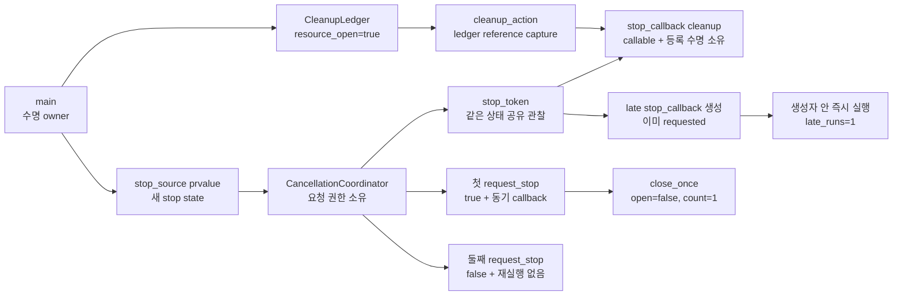

# 2026-10-27 — `std::stop_callback` 정리 경계와 함수형 그래프 거리 질의

오늘은 C++20 `std::stop_source`, `std::stop_token`, `std::stop_callback`으로 **취소 요청 권한·관찰 권한·정리 callback의 등록 수명**을 분리한다. 실무 예제는 열린 자원을 닫는 callback을 scope에 등록하고, 첫 요청이 callback을 동기 실행하며 반복 요청은 아무 일도 하지 않는다는 단조 상태를 검증한다. 이미 요청된 token에 늦게 등록한 callback은 생성자 안에서 즉시 실행된다.

대회 문제는 [CSES 1160 — Planets Queries II](https://cses.fi/problemset/task/1160/)다. 함수형 그래프를 사이클과 그쪽으로 흘러드는 역방향 트리로 분해하고, 성분·사이클 위치·사이클까지 깊이와 binary lifting 표를 결합해 최소 순간이동 횟수를 답한다.

## 오늘의 목표

1. `stop_source`의 요청 권한, `stop_token`의 공유 상태 관찰, `stop_callback`의 RAII 등록 수명을 구분한다.
2. 첫 `request_stop()`만 `true`이고 등록 callback들을 반환 전에 동기 실행한다는 계약을 설명한다.
3. 이미 요청된 token의 late callback이 생성자 안에서 즉시 실행되는 재진입 지점을 안전하게 다룬다.
4. lvalue/prvalue/xvalue, 참조 capture, closure 이동, 객체 수명, 공유 stop state 소유권과 보장 복사 생략을 실제 식으로 추적한다.
5. 함수형 그래프의 사이클 제거, 역간선 BFS, cycle position, binary lifting 불변식을 증명한다.
6. 트리 목적지와 사이클 목적지의 도달 가능 조건을 분리하고 `O((n+q) log n)` 시간·`O(n log n)` 공간을 설명한다.
7. 모든 표준 라이브러리 첫 호출을 수신자·overload·인자·반환·사후 상태·오류/복잡도/수명/thread의 여섯 항목으로 읽는다.

## 생성 파일

- [`main.cpp`](main.cpp): callback 수명 안에서 자원을 한 번만 닫는 취소 조정자 실무 예제
- [`problem.cpp`](problem.cpp): 두 live callback과 하나의 late callback을 값으로 검증하는 초보자 실습
- [`icpc_problem.cpp`](icpc_problem.cpp): CSES 1160에 제출 가능한 반복형 완전 풀이
- [`CMakeLists.txt`](CMakeLists.txt): C++23 엄격 경고 빌드와 exact-output CTest
- [`run_icpc_test.cmake`](run_icpc_test.cmake): stdin/stdout/종료 코드를 비교하는 CTest helper
- [`CHECKPOINT.md`](CHECKPOINT.md): 문법·값 범주·호출 계약·함수형 그래프를 스스로 설명하는 검증 문제

공용 지식은 중복 파일을 만들지 않고 기존 대표 문서를 멱등적으로 보강한다.

- [`../algorithm/functional-graph-cycle-peeling.md`](../algorithm/functional-graph-cycle-peeling.md): 사이클 제거, 성분/깊이/위치, binary lifting 질의, 증명과 실수
- [`../standard-library/concurrency-time-filesystem.md`](../standard-library/concurrency-time-filesystem.md): 공유 stop state와 source/token/callback 호출·수명·thread 계약
- [`../standard-library/containers-and-views.md`](../standard-library/containers-and-views.md): `vector` 저장·재할당·첨자·size 계약
- [`../standard-library/io-parsing-and-utilities.md`](../standard-library/io-parsing-and-utilities.md): stream 연산, `std::move`, `std::size_t`와 종료 계약

## `main.cpp` 구조도

`ledger`는 callback보다 먼저 생성되어 나중에 파괴된다. closure의 `&ledger`는 참조만 저장하고 수명을 늘리지 않지만 선언·block 순서가 callback 실행과 파괴가 끝날 때까지 ledger를 살려 둔다. `token`은 coordinator 객체를 빌리는 reference가 아니라 같은 내부 stop state를 공유하는 값 handle이다. 다만 stop을 요청할 권한은 source에만 있다.

## 기초 문법부터 읽기

- `#include <stop_token>`은 `stop_source`, `stop_token`, class template `stop_callback<Callback>`을 선언한다. `<iostream>`은 `std::cout`, `<utility>`는 `std::move`를 선언한다.
- `int`는 callback 횟수·점수를 담는 기본 정수 타입이고 `bool`은 요청 성공과 자원 상태를 담는다. `CleanupCount callback_runs{};`의 `{}`는 0, `bool resource_open{true};`는 true로 초기화한다.
- `using CleanupCount = int;`는 읽기 좋은 별칭일 뿐 새 강한 타입이 아니다. `using CleanupCallback = std::stop_callback<decltype(cleanup_action)>;`의 template 인자는 저장할 closure의 정확한 타입이다.
- `struct CleanupLedger`의 기본 접근은 `public`, `class CancellationCoordinator`의 기본 접근은 `private`다. `public:`은 요청·관찰 인터페이스만 열고 `private:` source 교체를 막는다. 접근 제어는 compile-time 규칙이지 runtime 보안 장치가 아니다.
- `explicit CancellationCoordinator(std::stop_source source)`는 source 하나가 coordinator로 암시 변환되는 일을 막는다. `: source_{std::move(source)}` 멤버 초기화 목록은 생성자 본문 전에 선언 순서대로 source 수명을 시작한다.
- `token() const`의 뒤 `const`는 coordinator의 관찰 가능한 상태를 바꾸지 않는다는 뜻이다. `std::stop_token`은 값으로 반환되어 공유 stop state 수명을 유지한다.
- `[&ledger]`의 `&` capture는 기존 객체를 참조한다. raw pointer처럼 대상을 소유하지 않고 ledger 수명을 늘리지 않는다. callback이 더 오래 살면 댕글링하므로 선언 순서와 동기화가 계약의 일부다.
- `if (resource_open) { ... }`는 bool load·비교 결과가 true인 block만 실행한다. `{}` block은 callback 객체가 등록된 수명 범위를 만들기도 한다.
- `void close_once() noexcept`는 반환값이 없고 예외가 함수 밖으로 나가지 않는다고 약속한다. stop callback에서 예외가 빠져나오면 종료로 이어질 수 있어 정리 경로는 `noexcept`로 설계했다.

직접 해보기: 첫 `request_stop()`을 callback 생성 전으로 옮기고 출력이 어떻게 달라지는지 예측한다. 다음으로 callback block을 요청 전에 끝내 등록을 해제하면 `cleanup`이 0인지 확인한다. `close_once()`의 `if`를 지우고 같은 closure를 서로 다른 callback 두 개에 등록하면 “자원은 한 번 닫힌다”는 불변식이 왜 깨지는지도 설명한다.

## 실무 Modern C++ 패턴: 취소 신호를 정리 adapter에 연결하기

polling만 가능한 코드는 작업 본문이 주기적으로 `stop_requested()`를 확인해야 한다. 반면 외부 I/O 취소, wait 깨우기, handle 정리처럼 요청 순간에 실행해야 하는 작은 동작은 callback 등록이 자연스럽다. source를 application/service 계층에, token을 operation 계층에 전달하면 operation은 요청 권한 없이 자신의 정리만 등록할 수 있다.

첫 요청은 상태를 원자적으로 단 한 번 전환하고 현재 등록된 callback들을 `request_stop()`이 반환하기 전에 실행한다. callback 실행 순서는 보장되지 않으므로 서로 다른 callback 사이에 순서 의존성을 만들지 않는다. callback 하나가 오래 걸리면 요청 호출도 오래 걸리며, callback이 예외를 내보내면 `std::terminate`다. 오늘 closure가 `noexcept`이고 `close_once()`가 멱등인 이유다.

`stop_callback`은 copy도 move도 할 수 없다. 객체 위치와 등록 수명이 하나로 묶여 있기 때문이다. callback 소멸자는 미래 실행을 등록 해제하고, 다른 thread에서 자기 callback이 실행 중이면 완료까지 기다릴 수 있다. 이 성질이 captured reference 파괴 전에 callback 실행이 끝나게 하는 도구가 되지만, 다른 코드가 같은 대상에 동시에 접근하는 것까지 자동으로 안전하게 만들지는 않는다.

## 값 범주·복사/이동·수명·소유권

- `coordinator`, `token`, `ledger`, `cleanup_action`처럼 이름 있는 식은 lvalue다. 선언 타입이 참조여도 이름으로 사용한 식은 lvalue라는 규칙은 같다.
- `std::stop_source{}`는 새 상태를 만드는 prvalue다. coordinator의 값 매개변수를 직접 초기화한 뒤 `std::move(source)`가 source를 xvalue로 바꿔 멤버의 이동 생성을 선택 가능하게 한다.
- `std::move` 자체는 어떤 byte도 옮기지 않는다. 실제 공유 상태 handle 이전은 `stop_source` 이동 생성자가 수행하고 moved-from source는 유효하지만 연관 상태가 없는 상태가 된다.
- `std::move(cleanup_action)`은 closure xvalue다. closure가 가진 것은 ledger reference이므로 closure 이동이 ledger를 이동하거나 소유하지 않는다.
- `coordinator.token()`이 반환한 `stop_token` prvalue는 지역 token을 직접 초기화한다. 같은 타입 prvalue의 직접 초기화는 C++17 보장 복사 생략 대상이고, 이름 있는 지역 반환의 선택적 NRVO와 구별한다.
- source, token과 등록 callback은 내부 stop state의 수명을 공유한다. `stop_token`은 coordinator 객체 자체의 reference가 아니어서 source wrapper보다 오래 살 수 있지만, 요청 권한은 없다.
- callback이 capture한 ledger/score는 여전히 바깥 scope가 소유한다. callback 파괴·실행보다 먼저 그 대상이 파괴되면 댕글링과 미정의 동작이므로 owner를 먼저 만들고 observer/registration을 나중에 만든다.

## ICPC 문제: CSES 1160 — Planets Queries II

| 항목 | 내용 |
|---|---|
| 문제 | **CSES 1160 — Planets Queries II** |
| 공식 출처 | [CSES Problem Set](https://cses.fi/problemset/task/1160/) |
| 입력 | 행성 수 `n`, 질의 수 `q`, 각 정점의 유일한 다음 정점 `next[i]`, 질의 `(a,b)` |
| 출력 | `a`에서 `b`까지 최소 순간이동 횟수, 불가능하면 `-1` |
| 공식 제약 | `1 ≤ n,q ≤ 200,000`, 시간 1초, 메모리 512MB |
| 핵심 알고리즘 | indegree peeling + cycle 좌표 + 역간선 BFS + binary lifting |
| 복잡도 | 전처리 `O(n log n)`, 질의당 `O(log n)`, 전체 `O((n+q) log n)`, 공간 `O(n log n)` |

### 구조와 불변식

각 정점의 outgoing edge가 정확히 하나이므로 각 약한 연결 성분은 유향 사이클 하나와 그 사이클로 흘러드는 나무들로 이루어진다. 진입 차수 0 정점을 연쇄 제거하면 사이클 정점만 남는다. 사이클을 한 바퀴 돌며 `component`, `cycle_position`, `cycle_length`를 기록하고, 모든 사이클 정점을 seed로 역간선 BFS하면 바깥 정점에 `depth_to_cycle`과 같은 component를 전파할 수 있다.

`jump[k][v]`는 `v`에서 정확히 `2^k`번 이동한 정점이다. `jump[k][v] = jump[k-1][jump[k-1][v]]`가 성립하며, `advance(v,d)`는 `d`의 set bit만 골라 `O(log n)`에 이동한다.

질의는 목적지 종류로 나눈다.

1. component가 다르면 간선이 다른 성분으로 나갈 수 없어 `-1`이다.
2. `b`가 트리 정점이면 `depth[a] >= depth[b]`여야 한다. `a`를 깊이 차만큼 올린 실제 정점이 `b`와 같을 때만 그 차가 답이다. 같은 깊이만으로는 합류하지 않은 형제 가지를 구별할 수 없다.
3. `b`가 사이클 정점이면 `a`를 `depth[a]`만큼 올려 cycle entry를 구한다. 답은 그 꼬리 거리와 `(pos[b]-pos[entry]+cycle_length)%cycle_length`를 더한 값이다.

### 정확성 요약

- 사이클 정점은 사이클 내부 predecessor 때문에 indegree가 끝까지 1 이상이고, 사이클 밖 DAG에는 제거 가능한 indegree 0 정점이 있으므로 peeling 뒤 남는 정점은 정확히 사이클이다.
- 역간선 BFS는 이미 배정된 사이클/부모에서 자식으로만 내려가므로 각 트리 정점에 유일한 cycle entry까지의 정확한 거리와 component를 준다.
- binary lifting 점화식은 두 번의 `2^(k-1)` 이동을 합친 것이므로 귀납적으로 정확하다.
- 트리에서는 유일한 successor 열만 따라가므로 depth 차를 올린 정점과 목적지가 같다는 조건이 필요충분이다. 사이클에서는 entry 이후 이동이 cycle position의 순방향 모듈러 차와 정확히 같다.

### 대회 우승 관점의 구현 결정

- 출발점마다 직접 따라가면 최악 `O(nq)`다. 구조 metadata와 jump table을 한 번 만들면 200,000개 질의를 제한 안에 처리한다.
- 재귀 DFS 대신 vector 기반 peeling/BFS를 써 길이 200,000 꼬리에서도 호출 stack을 쓰지 않는다.
- `depth == -1`을 미배정 sentinel로 사용해 reverse BFS가 사이클 간선으로 다시 들어가는 것을 막는다.
- 목적지가 사이클인지 `depth[b] == 0`으로 판별하고, 트리 질의와 cycle 질의를 섞지 않는다.
- 정점 번호는 1-based, vector 크기는 `n+1`로 통일한다. 모든 첨자는 유효한 입력과 전처리 불변식 아래 `size_t`로 변환한다.
- 최대 답은 `n-1` 이하라 `int`로 충분하지만, `1 << level` 같은 shift는 level 범위와 피연산자 폭을 검토한다.

## 오늘 사용한 표준 라이브러리

| 핵심 심볼 | 선언 헤더 | 항목 종류 | 실제 호출 멤버/함수 | 현재 코드에서의 역할 | 대표 문서 |
|---|---|---|---|---|---|
| `std::stop_source`, `std::stop_token` | `<stop_token>` | 공유 stop-state source·token 타입 | `std::stop_source()`, `stop_source::get_token(`, `stop_source::request_stop(` | 요청 권한과 읽기/등록 handle 분리 | [`concurrency-time-filesystem.md`](../standard-library/concurrency-time-filesystem.md) |
| `std::stop_callback<Callback>` | `<stop_token>` | copy/move 불가 class template | `std::stop_callback<...>(token, callable)`, destructor/등록 해제 | live·late 정리 callback의 RAII 등록 수명 | [`concurrency-time-filesystem.md`](../standard-library/concurrency-time-filesystem.md) |
| `std::move` | `<utility>` | 함수 템플릿 | `std::move(` | source·closure lvalue를 xvalue로 변환 | [`io-parsing-and-utilities.md`](../standard-library/io-parsing-and-utilities.md) |
| `std::vector`, `std::size_t` | `<vector>`, `<cstddef>` | 연속 컨테이너·크기 타입 | 기본 생성자, count 생성자, fill 생성자, `vector::operator[]`, `vector::reserve`, `vector::push_back`, `vector::size` | successor, 역간선, peeling FIFO, cycle metadata, jump table 소유 | [`containers-and-views.md`](../standard-library/containers-and-views.md), [`io-parsing-and-utilities.md`](../standard-library/io-parsing-and-utilities.md) |
| `std::cin`, `std::cout`, `std::ios::sync_with_stdio` | `<iostream>` | stream 객체·정적 함수·연산자 | `sync_with_stdio(`, `std::cin.tie(`, `std::cin >>`, `std::cout <<`, `operator<<(std::ostream&, char)` | 저지 입력·정답과 학습 결과 출력 | [`io-parsing-and-utilities.md`](../standard-library/io-parsing-and-utilities.md) |

## 기계 실행 관점

`request_stop()`은 공유 상태의 원자적 판정/저장, 조건 분기와 등록 callable 간접 호출을 포함할 수 있다. `close_once()`는 bool load·비교·분기·store로 나타날 수 있다. 함수형 그래프 전처리는 연속 vector에서 첨자 load/store와 조건 분기를 반복하고, jump table은 level별 연속 순회로 locality를 활용할 수 있다. 그러나 callback inline 여부, lock 사용, 실제 명령, branch 제거와 cache 동작은 CPU·ABI·표준 라이브러리·컴파일러·최적화 옵션과 입력에 따라 달라 특정 assembly나 lock-free 구현을 단정하지 않는다.

## 검증 결과

- w64devkit GCC 16.1.0의 C++23 Release 엄격 경고(`-Werror`, `_GLIBCXX_ASSERTIONS`) 빌드와 CTest **7/7**이 통과했다.
- 두 Modern C++ 실행 파일의 live callback 1회, 반복 요청 false, late callback 즉시 실행을 stdout 전체로 비교했다.
- 공식 예제, 자기 루프, 여러 성분, cycle wrap-around, 긴 꼬리·합류 가지, 같은 깊이의 다른 가지와 같은 성분 `cycle → tree` 불가를 exact-output CTest로 고정했다.
- 고정 seed `116027`의 무작위 함수형 그래프 20개, 모든 ordered pair 44,334개를 최대 `n`번 직접 따라가는 oracle과 대조했다.
- `n=q=200,000` 최대 긴 꼬리·자기 루프와 길이 200,000 단일 cycle에서 각각 정답 200,000개를 전부 검증했다. process I/O를 포함한 로컬 측정은 약 0.85초와 0.66초였다.
- 공용 알고리즘 문서의 C++ block 2개를 같은 엄격 경고로 문법 검사했고, 변경 Markdown 9개의 상대 링크 493개가 모두 유효했다.
- 15개 의도 파일의 UTF-8, 마지막 LF, trailing whitespace, 날짜 폴더 build artifact 부재와 scoped diff를 확인했다.
- 표준 라이브러리 `latest`/`all` 감사가 통과했다. 전체 범위는 79개 날짜, C++ 218개, 심볼 203개, 헤더 59개, 멤버 65개, 연산군 5개다.
